# Лабораторная работа № 5. Анализ потребляемой мощности и сети питания в Cadence Voltus

В предыдущей работе вы выполнили placement, CTS и routing цифрового блока. Теперь определим его потребляемую мощность и проверим, какое напряжение получают ячейки через построенную сеть питания.

<a id="fig-lab5-intro-overview"></a>

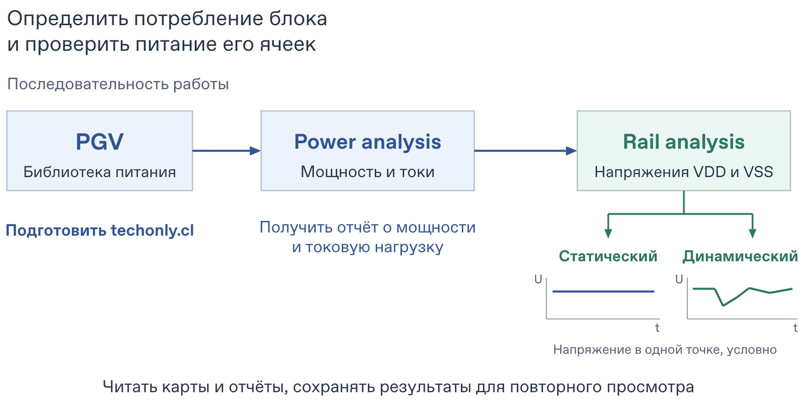

*Рисунок — PGV и рассчитанные токи используются при статическом и динамическом анализе сети питания.*

**Цель работы** — подготовить PGV, рассчитать потребляемую мощность, выполнить статический и динамический анализ сети питания, научиться читать карты и отчёты Voltus и сохранять результаты для повторного просмотра.

Состав заданий и материалы для сдачи приведены в [разделе 8](#lab5-assessment).

Примеры скриптов рассчитаны на **Voltus 20.10 Stylus Common UI**. В учебной конфигурации используются `s13207` и NanGate45.

## Содержание

1. [Назначение анализа](#lab5-purpose)
2. [Основные понятия](#lab5-basics)
   - [Допустимое падение напряжения](#lab5-ir-limit)
3. [Послойный расчёт сети питания 45 нм](#lab5-pdn-calculation)
   - [Исходный floorplan](#lab5-pdn-inputs)
   - [Ток и потери на M9](#lab5-pdn-currents)
   - [Полосы M8](#lab5-pdn-m8)
   - [Участки M7](#lab5-pdn-m7)
   - [Переходы между слоями](#lab5-pdn-vias)
   - [Сквозная оценка](#lab5-pdn-summary)
   - [Ширина и шаг полос](#lab5-pdn-sizing)
   - [Итоговый вид и параметры расчётного примера](#lab5-pdn-final-view)
   - [Электромиграция](#lab5-electromigration)
4. [Подготовка и запуск](#lab5-preparation)
5. [Практические этапы](#lab5-practice)
   - [Физическая реализация](#lab5-physical-flow)
   - [Генерация PGV](#lab5-pgv)
   - [Статический анализ](#lab5-static)
   - [Просмотр в GUI](#lab5-gui)
   - [Динамический анализ](#lab5-dynamic)
6. [Разбор результатов](#lab5-results)
7. [Сохранение данных](#lab5-save)
8. [Задания и защита](#lab5-assessment)

<a id="lab5-purpose"></a>

## 1. Назначение анализа

Питание поступает к ячейкам через металлические проводники и переходы между слоями. У них есть сопротивление, поэтому при протекании тока возникает падение напряжения. В результате напряжение между выводами **VDD и VSS ячейки** может быть ниже заданного на источнике.

В **Voltus** выполняем два связанных расчёта.

<a id="fig-lab5-flow"></a>

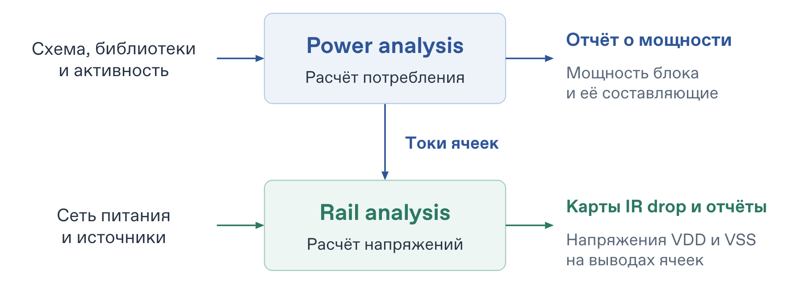

*Рисунок — Токи ячеек связывают расчёт потребления с расчётом напряжений в сети питания.*

1. **Power analysis — расчёт потребления.** По данным схемы, библиотек и активности определяем потребляемую мощность и токи ячеек. Получаем отчёт о мощности и токовую нагрузку для анализа сети питания.
2. **Rail analysis — расчёт сети питания.** Используем токи ячеек, модель проводников и переходов, напряжения и расположение источников. Рассчитываем напряжения VDD и VSS, получаем карты IR drop и отчёты.

Так определяем, **сколько потребляет блок** и **какое питание получают его ячейки**.

Результат зависит от библиотек, напряжения, температуры, активности и конфигурации сети питания. Эти условия и расположение источников сохраняем вместе с отчётами, чтобы расчёт можно было повторить и корректно сравнить с другим вариантом.

<a id="lab5-basics"></a>

## 2. Основные понятия

### 2.1. Сеть питания

**Сеть питания (PDN — Power Distribution Network)** — это металлические проводники и межслойные переходы, которые соединяют источник питания с ячейками схемы.

В работе используем две сети.

- **VDD** — сеть питания. По ней ток поступает от источника к ячейкам.
- **VSS** — земля. По ней ток возвращается от ячеек к источнику.

У источника потенциал VSS принимаем равным **0 В**. В этой работе рассматриваем блок **без отключения питания**.

<a id="fig-lab5-pdn-basics"></a>

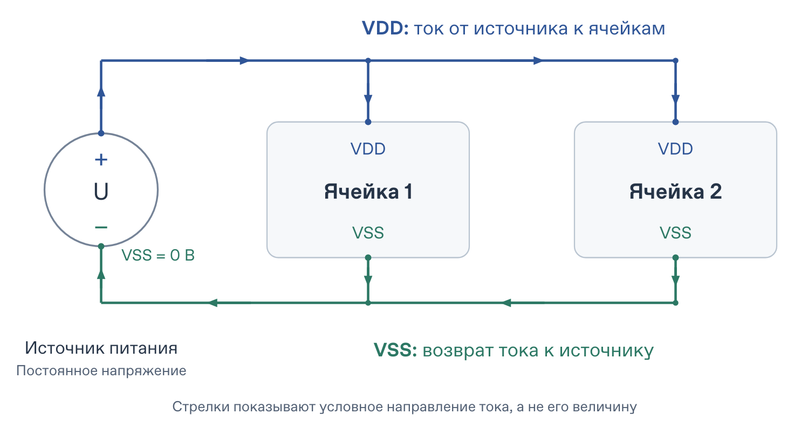

*Рисунок — По VDD ток поступает к ячейкам, а по VSS возвращается к источнику. Стрелки показывают только условное направление тока.*

В примере 45 нм питание подаётся снизу на боковые шины **M9**. Далее ток проходит через **M8, M7**, нижние слои и переходы к ячейкам. Общий вид этой сетки показан на [итоговом рисунке](#fig-lab5-pdn45-final).
### 2.2. Падение напряжения

Когда по проводнику течёт ток, на его сопротивлении возникает **падение напряжения**. Для рассматриваемого участка используем закон Ома:

$$
\Delta V=IR,
$$

где $I$ — ток через участок, а $R$ — его сопротивление.

У ячейки потенциал **VDD снижается**, а потенциал **VSS повышается** относительно соответствующих выводов источника. Оба изменения уменьшают напряжение питания ячейки. Поэтому берём разность потенциалов на её выводах:

$$
V_{\text{cell}}=VDD_{\text{local}}-VSS_{\text{local}}.
$$

Рассмотрим учебный пример.

| Точка измерения | VDD | VSS | Напряжение питания VDD−VSS |
|---|---:|---:|---:|
| На выводах источника | 1,10 В | 0 В | 1,10 В |
| На выводах ячейки | 1,08 В | 0,01 В | **1,07 В** |

Ячейка получает **1,08 − 0,01 = 1,07 В**. Падение по VDD составляет **20 мВ**, подъём VSS — **10 мВ**. Суммарная потеря питания равна **20 + 10 = 30 мВ**.

<a id="fig-lab5-ir-drop-basics"></a>

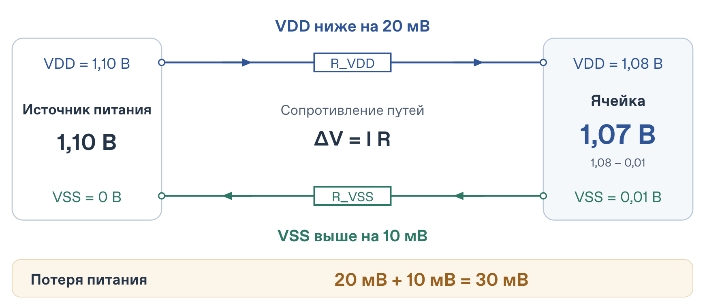

*Рисунок — Напряжение питания определяем между VDD и VSS одной ячейки. Потери в обоих путях складываются.*

#### Почему снижение питания увеличивает задержку

Чтобы изменить логический уровень на выходе, ячейка должна **зарядить или разрядить ёмкостную нагрузку** — ёмкости проводников и входов следующих ячеек. Например, в КМОП-инверторе при переходе выхода 0→1 нагрузка заряжается через PMOS-транзистор от VDD, а при переходе 1→0 разряжается через NMOS-транзистор к VSS.

При снижении напряжения питания транзисторы в обычном режиме **обеспечивают меньший ток**: уменьшается запас управляющего напряжения относительно порога их открывания. При той же ёмкости меньший ток означает более медленное изменение выходного напряжения. Поэтому обычно увеличиваются **длительность фронта и спада сигнала**, а также **задержка распространения через ячейку**.

Хотя при меньшем питании уменьшается и размах выходного сигнала, снижение тока обычно оказывает более сильное влияние. В результате переключение занимает больше времени.


### 2.3. Допустимое падение напряжения

**Допустимое падение напряжения, или IR-drop budget,** — это предел потери напряжения питания ячейки относительно номинального. В этом примере он учитывает вместе **падение VDD и подъём VSS**.

Для учебного примера зададим допустимую потерю **2% от 1,1 В**:

$$
\Delta V_{\text{lim}}=1{,}1\cdot0{,}02=0{,}022\;\text{В}=22\;\text{мВ}.
$$

Минимально допустимое питание ячейки:

$$
V_{\text{cell,min}}=1{,}1-0{,}022=1{,}078\;\text{В}.
$$

Один и тот же критерий можно проверить двумя способами.

| Проверяемая величина | Условие | Пример из §2.2 |
|---|---:|---:|
| Суммарная потеря питания | Не более **22 мВ** | 30 мВ |
| Питание ячейки VDD−VSS | Не ниже **1,078 В** | 1,070 В |

В примере из §2.2 **бюджет превышен на 30 − 22 = 8 мВ**. Питание ячейки 1,070 В ниже минимально допустимых 1,078 В.

<a id="fig-lab5-ir-budget-basics"></a>

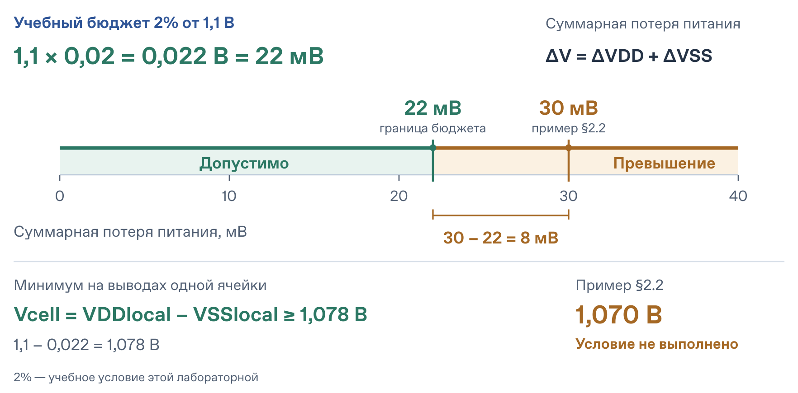

*Рисунок — Бюджету 22 мВ соответствует минимальное питание ячейки 1,078 В. Пример с потерей 30 мВ этому условию не соответствует.*

Для расчёта VDD−VSS берём потенциалы **одной и той же ячейки**. В динамическом анализе они должны относиться к одному моменту времени; также фиксируем интервал и выбранную метрику проверки.

Допустимую потерю напряжения можно задавать **для питания ячейки VDD−VSS** или **отдельно для каждой сети**. В первом случае падение VDD и подъём VSS складывают и сравнивают с общим пределом. Во втором — для падения VDD и подъёма VSS устанавливают свои пределы и проверяют их по отдельности.

**В этой работе 2% — учебный предел суммарной потери питания ячейки.** В реальном проекте допустимые значения определяют по требованиям к питанию и надёжной работе схемы. Порядок проверки приведён в [§6.3](#lab5-ir-limit-check).
### 2.4. Состав потребляемой мощности

Любая реальная логическая ячейка потребляет энергию. Для этого ей не обязательно состоять из нескольких логических элементов. Рассмотрим **простой КМОП-инвертор**, который содержит один PMOS- и один NMOS-транзистор и выполняет функцию:

$$
Y=\neg A.
$$

При установившемся **A = 0** PMOS открыт, NMOS закрыт и на выходе получается **Y = 1**. При **A = 1** состояния транзисторов меняются и получается **Y = 0**. Выход соединён проводниками со входами следующих ячеек; их суммарная ёмкость образует внешнюю нагрузку инвертора.

В отчёте Voltus выделяются три составляющие мощности.

| Составляющая | Что описывает | На примере инвертора |
|---|---|---|
| **Internal power** | Собственное потребление ячейки при переключениях, описанное её библиотечной моделью | Кратковременный сквозной ток и переходные процессы с участием паразитных ёмкостей транзисторов |
| **Switching power** | Заряд и разряд внешней ёмкостной нагрузки выхода | Перезаряд ёмкостей проводников и входов следующих ячеек |
| **Leakage power** | Токи утечки, которые сохраняются и без переключений | Малые токи через транзисторы при постоянном входном уровне |

<a id="fig-lab5-power-components"></a>

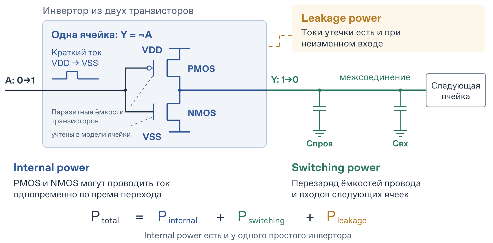

*Рисунок — Все три составляющие относятся к одной ячейке. Internal power существует и у простого инвертора без промежуточных логических каскадов. Паразитные ёмкости и импульс сквозного тока показаны условно; разделение потребления при расчёте задаётся библиотечной моделью.*

Общая мощность равна сумме составляющих:

$$
P_{\text{total}}=P_{\text{internal}}+P_{\text{switching}}+P_{\text{leakage}}.
$$

#### Internal power: что расходуется внутри ячейки

Даже в простом инверторе есть два механизма внутреннего потребления.

- **Кратковременный сквозной ток.** Вход меняет напряжение за конечное время. Во время перехода PMOS и NMOS могут некоторое время проводить одновременно, создавая путь **VDD→VSS** через оба транзистора. Энергия рассеивается в транзисторах. При медленном входном фронте время их одновременной проводимости может увеличиваться.
- **Переходные процессы с участием паразитных ёмкостей.** Реальные транзисторы обладают собственными ёмкостями. При изменении напряжений на их выводах заряды перераспределяются. Эти процессы учитываются при подготовке модели потребления ячейки, даже если отдельного логического узла между каскадами нет.

**Где проходят токи в инверторе.** Рассмотрим переход входа A: 0→1, при котором выход Y меняется 1→0.

- **Красным показан сквозной ток:** VDD → канал PMOS → канал NMOS → VSS. Во время перехода оба транзистора могут проводить одновременно. Эта составляющая тока проходит через ячейку, минуя внешнюю нагрузку, и даёт вклад в internal power.
- **Зелёным показан разряд внешней нагрузки $C_L$.** Заряд уходит с выходного узла через NMOS к VSS. Затраты на переключение этой нагрузки относятся к switching power.

<a id="fig-lab5-inverter-internal-detail"></a>

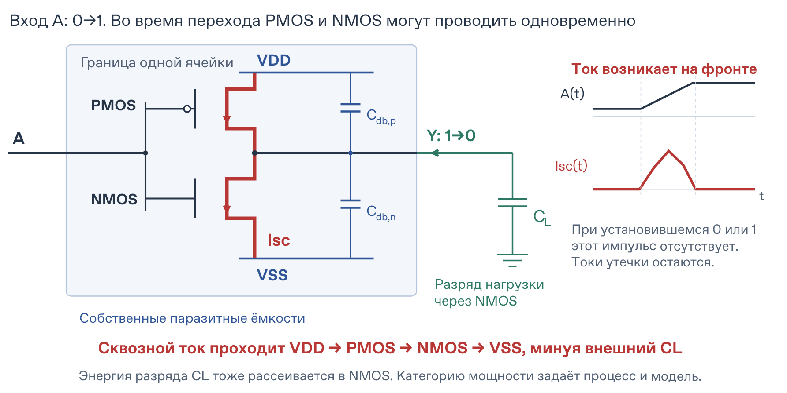

*Рисунок — Через NMOS могут одновременно протекать сквозная составляющая тока и ток разряда нагрузки. Цвет выделяет процесс, а не отдельный физический канал. Пути и временные зависимости показаны условно.*

**Где находятся паразитные ёмкости.** На увеличенном разрезе NMOS видны затвор, оксид, исток, сток и тело транзистора. Ёмкость $C_{gd}$ связывает затвор и сток; одна из её составляющих возникает в области их перекрытия. Ёмкость $C_{db}$ связана с p–n-переходом между областью стока и телом транзистора. При изменении напряжений заряд этих структур меняется.

На схеме инвертора тело PMOS принято подключённым к VDD, а тело NMOS — к VSS. Поэтому собственные ёмкости сток–тело показаны как $C_{db,p}$ между Y и VDD и $C_{db,n}$ между Y и VSS.

<a id="fig-lab5-transistor-internal-detail"></a>

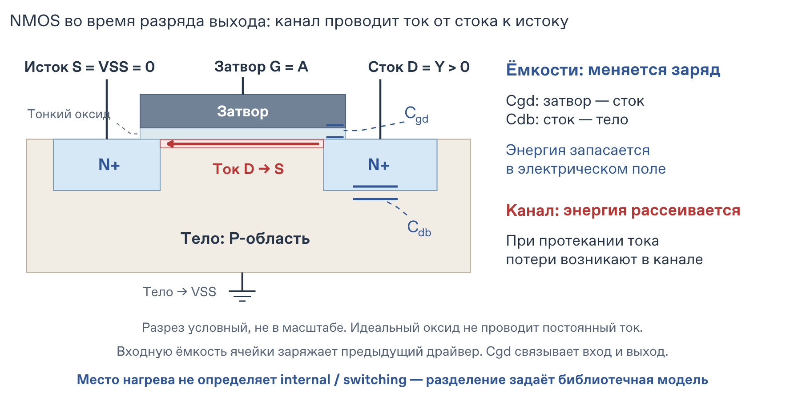

*Рисунок — В показанном режиме NMOS открыт, а потенциал стока выше потенциала истока. Условный ток идёт от стока к истоку через канал под затвором. Идеальный оксид изолирует затвор от канала. Геометрия и распределение заряда показаны схематично, без соблюдения масштаба.*

**Место нагрева само по себе не определяет категорию мощности.** В канале NMOS рассеивается и энергия сквозного тока, и энергия разряда внешней нагрузки. Идеальная ёмкость хранит энергию; потери возникают в сопротивлениях токового пути. Поэтому internal и switching разделяют по учитываемым процессам и правилам библиотечной модели.

**Как получает эти данные Voltus.** Библиотеку заранее характеризуют с помощью транзисторного моделирования для разных входных фронтов, нагрузок и условий. Данные о собственном потреблении ячейки сохраняют в библиотечной модели с принятым разделением внутреннего потребления, внешней нагрузки и утечек. Поэтому для инвертора Voltus использует его модель, а для элемента И, буфера или триггера — модель соответствующей ячейки.

Смысл среднего значения можно записать так:

$$
P_{\text{internal}}=\frac{\sum_e E_{\text{internal},e}}{T_{\text{obs}}},
$$

где $T_{\text{obs}}$ — интервал усреднения, а $E_{\text{internal},e}$ — энергия внутреннего потребления, соответствующая учтённому событию $e$. Сумма описывает затраты за весь интервал. В расчёте используются библиотечные данные и активность сигналов; внутренние транзисторные процессы не требуется заново рассчитывать вручную для каждой ячейки.

Энергия события зависит, в частности, от **transition/slew входа**, выходной нагрузки и, для многовходовой ячейки, состояния остальных входов. Внешняя нагрузка меняет условия переключения выходных транзисторов, поэтому от неё может зависеть и internal power. Затраты на перезаряд самой внешней нагрузки при этом учитываются отдельно в switching power.

**Входная ёмкость инвертора — нагрузка для предыдущего драйвера.** Её заряд и разряд относятся к переключению выходной нагрузки той ячейки, которая формирует сигнал A. Не следует повторно добавлять эту же энергию к internal power инвертора. При этом отдельная ёмкость $C_{gd}$ связывает вход и выход, поэтому её энергетический вклад нельзя целиком приписывать только одной стороне без учёта библиотечной модели.

#### Switching power: переключение внешней нагрузки

Внешняя нагрузка выхода включает проводники и входы следующих ячеек:

$$
C_L=C_{\text{wire}}+\sum C_{\text{pin}}.
$$

Для полных переключений выхода между 0 и постоянным напряжением питания $U$ среднюю мощность оцениваем так:

$$
P_{\text{switching}}\approx C_LU^2\nu_{01},
$$

где $\nu_{01}$ — **число переходов выхода 0→1 в секунду**, а $U=VDD-VSS$. Эта величина не обязательно совпадает с частотой тактового сигнала.

При зарядке нагрузки от 0 до $U$ источник отдаёт энергию $C_LU^2$. Половина запасается в ёмкости, а половина рассеивается в пути заряда. При последующем разряде запасённая энергия рассеивается в пути разряда. Идеальная ёмкость сама не превращает энергию в тепло; switching power учитывает затраты на её переключение.

#### Leakage power: потребление без переключений

Даже при постоянном входном логическом уровне через реальные транзисторы протекают токи утечки. При постоянном питании:

$$
P_{\text{leakage}}=U\,\overline{I_{\text{leak}}},
$$

где $\overline{I_{\text{leak}}}$ — средний ток утечки. Он зависит от состояния ячейки и условий расчёта. Утечки существуют и во время активности схемы. Поэтому отсутствие переключений не означает нулевое потребление.

<a id="fig-lab5-power-formulas"></a>

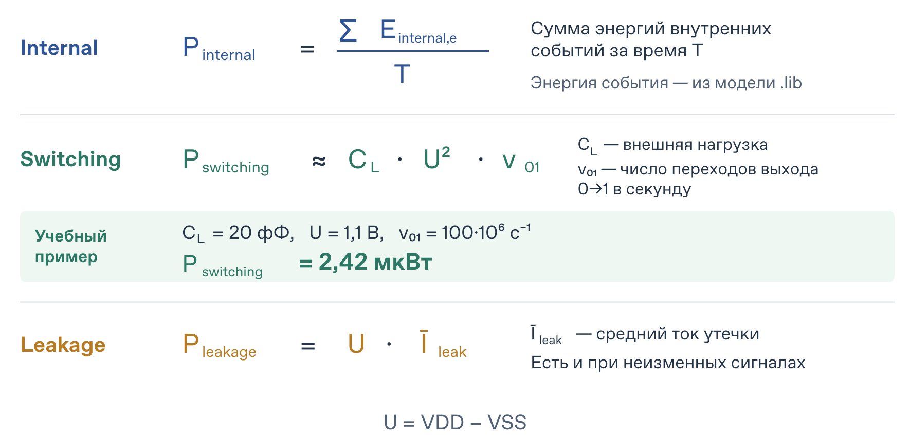

*Рисунок — Среднюю internal power связываем с энергией событий, switching power — с ёмкостью и активностью выхода, leakage power — с током утечки. На рисунке T обозначает интервал усреднения.*

**Учебный пример.** Пусть $C_L=20\;\text{фФ}$, $U=1{,}1\;\text{В}$, а выход совершает $100\cdot10^6$ переходов 0→1 в секунду. Тогда:

$$
P_{\text{switching}}\approx20\cdot10^{-15}\cdot1{,}1^2\cdot100\cdot10^6
=2{,}42\;\text{мкВт}.
$$

Это мощность переключения выбранной выходной нагрузки, а не общая мощность блока.

Для оценки **среднего тока** блока с одним постоянным напряжением питания используем его среднюю общую мощность:

$$
I_{\text{avg}}\approx\frac{P_{\text{total}}}{U}.
$$

Мощность и ток должны относиться к одному режиму и интервалу усреднения. Из этого расчёта нельзя определить пиковый ток. Перед подстановкой чисел проверьте **единицы мощности в заголовке отчёта**.

### 2.5. Активность переключений

**Активность переключений относится к сигналу на конкретном узле схемы:** входе, выходе или внутреннем межсоединении. Её можно оценить у сигналов любых ячеек — И, ИЛИ, НЕ, буферов, триггеров и других. Это не постоянная характеристика типа ячейки: она зависит от данных, логической функции и режима работы.

Чем чаще выход меняет значение, тем чаще его драйвер заряжает и разряжает нагрузку. При одинаковых ёмкости и напряжении больше переключений за то же время означает большую switching power.

**Активность и transition/slew — разные величины.** Активность описывает, как часто сигнал переключается, а transition/slew — сколько времени занимает один фронт или спад.

#### Как активность связана с логикой схемы

Один входной сигнал может вызвать разную активность на выходах разных ячеек.

- У **инвертора** изменение входа A вызывает противоположное изменение выхода X. Для показанных достаточно длинных импульсов каждое входное переключение проходит на выход с инверсией и задержкой.
- У **элемента И** результат зависит от второго входа B. При B = 1 выход Y повторяет A с задержкой. При B = 0 выход Y остаётся равным 0, даже если A переключается.

<a id="fig-lab5-switching-activity"></a>

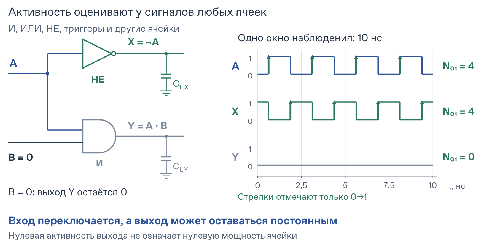

*Рисунок — За одинаковые 10 нс на A и X происходят по четыре перехода 0→1, а на Y — ни одного. Выходы имеют собственные нагрузки. Фронты и задержки показаны условно.*

Чтобы связать активность с формулой мощности, отдельно считаем переходы **0→1**:

$$
\nu_{01}=\frac{N_{01}}{T_{\text{obs}}},
$$

где $N_{01}$ — число переходов 0→1, а $T_{\text{obs}}$ — интервал наблюдения.

| Величина | Вход A | Выход инвертора X | Выход И Y при B = 0 |
|---|---:|---:|---:|
| Интервал наблюдения | 10 нс | 10 нс | 10 нс |
| Переходы 0→1 | 4 | 4 | 0 |
| $\nu_{01}$, переходов 0→1 в секунду | $400\cdot10^6$ | $400\cdot10^6$ | 0 |

У постоянного выхода Y нет затрат на полные переключения его внешней нагрузки. Однако **это не означает нулевую общую мощность ячейки И**: утечки сохраняются, а внутреннее потребление при изменениях A возможно.

Поэтому при расчёте всей схемы учитывают активность её отдельных сетей. Одинаковая активность на входах проекта не означает одинаковую активность всех внутренних сигналов.

**Не смешивайте все смены уровня и только переходы 0→1.** За полный цикл 0→1→0 происходят две смены уровня, но только одна из них заряжает нагрузку от 0 до U. В формуле из §2.4 величина $\nu_{01}$ учитывает именно переходы 0→1.

#### Зависит ли активность от периода такта

**Да, если при изменении периода сохраняется число переключений за такт.** Например, пусть выход Y меняет значение на каждом активном фронте clock: 0, 1, 0, 1 и так далее. Тогда один переход 0→1 происходит за два такта.

Обозначим среднее число переходов 0→1 за такт через $\alpha_{01}$. В этом примере $\alpha_{01}=0{,}5$. Если в интервал наблюдения входят M тактов с периодом $T_{\text{clk}}$, то:

$$
\alpha_{01}=\frac{N_{01}}{M},
\qquad
\nu_{01}=\frac{\alpha_{01}}{T_{\text{clk}}}
=\alpha_{01}f_{\text{clk}}.
$$

Здесь $\alpha_{01}$ — **среднее число переходов**, а не универсальная вероятность. При дополнительных импульсах за такт переходов может быть больше одного.

<a id="fig-lab5-activity-period"></a>

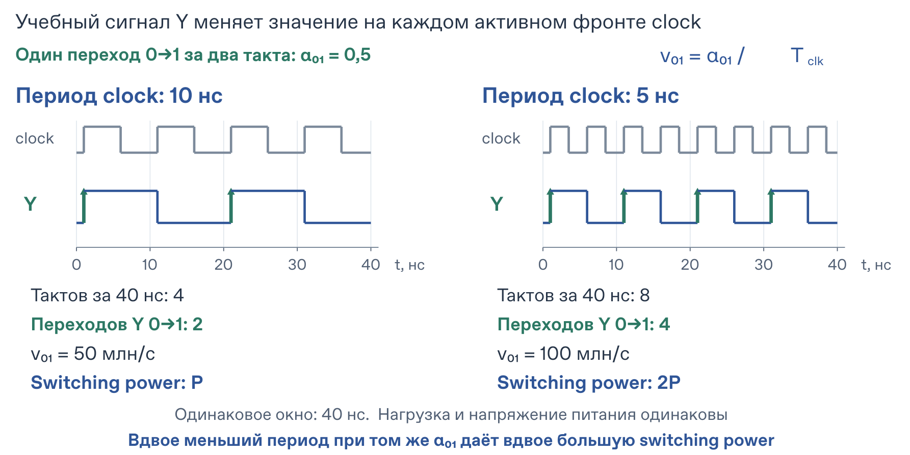

*Рисунок — Выход Y меняет значение на каждом активном фронте clock. Число переходов 0→1 за такт одинаково, но при меньшем периоде за то же время проходит больше тактов.*

| Величина | Режим 1 | Режим 2 |
|---|---:|---:|
| Интервал наблюдения $T_{\text{obs}}$ | 40 нс | 40 нс |
| Период такта $T_{\text{clk}}$ | 10 нс | 5 нс |
| Частота clock | 100 МГц | 200 МГц |
| Число тактов M | 4 | 8 |
| Переходы выхода 0→1 | 2 | 4 |
| $\alpha_{01}$, переходов 0→1 за такт | 0,5 | 0,5 |
| $\nu_{01}$, переходов 0→1 в секунду | $50\cdot10^6$ | $100\cdot10^6$ |
| Switching power при $C_L=20$ фФ и $U=1{,}1$ В | 1,21 мкВт | 2,42 мкВт |

При одинаковых $C_L$, U и $\alpha_{01}$:

$$
P_{\text{switching}}\approx C_LU^2\frac{\alpha_{01}}{T_{\text{clk}}}.
$$

В этом примере период уменьшился вдвое, поэтому **switching power выбранной нагрузки выросла вдвое**. Это условный результат для одной составляющей; общая мощность блока не обязана измениться в той же пропорции.

Если сигнал остаётся постоянным, увеличение частоты clock само по себе не заставляет его переключаться. Если реальная последовательность переключений во времени не меняется, смена выбранного опорного периода лишь меняет способ записи активности, а не физическое потребление.

#### Как активность задаётся в учебном маршруте

В учебных скриптах используется **оценочная активность**. Её начальные параметры задаёт команда `set_default_switching_activity`, затем `propagate_activity` распространяет оценки по схеме с учётом её логики. Результат зависит от принятых предположений о работе блока.

В Makefile настройте три параметра.

| Переменная | Что задаёт | Опция Tcl |
|---|---|---|
| `VOLTUS_INPUT_ACTIVITY` | Оценочную активность входных сигналов по умолчанию | `-input_activity` |
| `VOLTUS_ACTIVITY_PERIOD` | Опорный период для нормирования заданной активности | `-period` |
| `VOLTUS_CLOCK_GATE_RATIO` | Коэффициент для оценки активности выходов элементов clock gating | `-clock_gates_output_ratio` |

**Число в `VOLTUS_INPUT_ACTIVITY` нельзя напрямую подставлять вместо $\nu_{01}$ или $\alpha_{01}$.** В командах активности важно различать число всех смен уровня и число переходов 0→1. Формат и единицы проверьте через `help set_default_switching_activity`, а полученные оценки — через `get_activity`.

Опорный период активности, период clock и длительность расчёта — разные величины. `VOLTUS_ACTIVITY_PERIOD` задаёт нормирование активности, **не изменяет clocks из SDC** и **не задаёт длительность динамического анализа**. Фактический интервал динамического расчёта проверяют в логе.

Reset и другие управляющие сигналы должны соответствовать выбранному режиму работы. Например, при анализе обычной работы схемы **сброс должен быть зафиксирован в неактивном состоянии** с учётом его полярности. Настройки активности и состояния управляющих сигналов сохраните вместе с результатами.

### 2.6. Статический и динамический анализ

В обоих случаях Voltus рассчитывает напряжения в сети питания. Разница — в токах нагрузки, которые используются для расчёта.

| Анализ | Токи нагрузки | Что показывает |
|---|---|---|
| **Статический** | Средние токи ячеек | Падение напряжения при средней токовой нагрузке |
| **Динамический** | Токи ячеек, меняющиеся во времени | Изменение напряжения и кратковременные просадки |

#### Один ряд ячеек — два способа расчёта

Рассмотрим **один ряд размещения — row**, в котором находятся четыре стандартные ячейки U1–U4. Каждая подключена к общим шинам **VDD и VSS**. Через общий подвод питания проходит суммарный ток всех четырёх ячеек.

**В статическом анализе** каждой ячейке соответствует её средний ток. Например, если средний ток каждой из четырёх ячеек равен 0,25 мА, через общий подвод проходит 1 мА. По этим средним нагрузкам рассчитываются постоянные напряжения узлов.

**В динамическом анализе** для каждой ячейки используется ток во времени. Если несколько ячеек переключаются одновременно, их токовые импульсы складываются в общих участках сети. В отдельный момент ток может быть больше среднего, а потеря напряжения — выше.

<a id="fig-lab5-static-dynamic-row"></a>

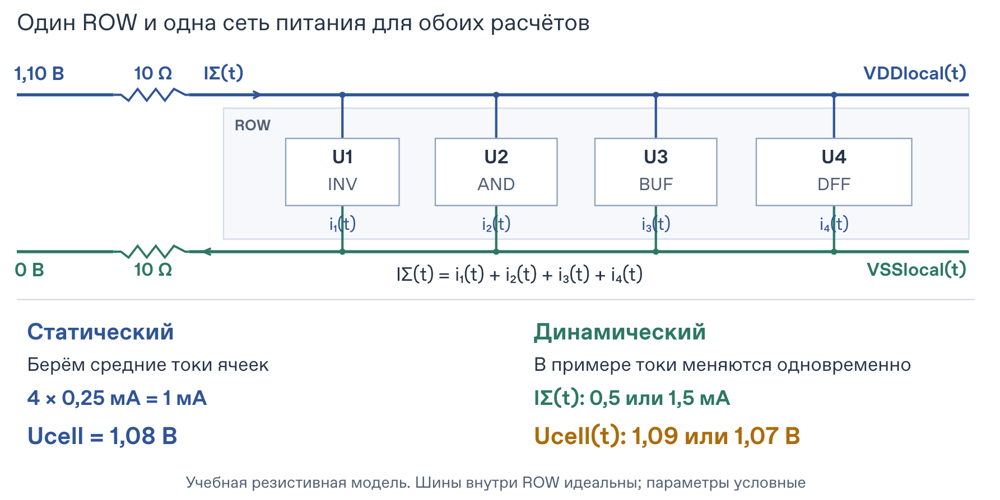

*Рисунок — Одна и та же физическая схема используется в обоих расчётах. В учебной модели сопротивления подводов VDD и VSS равны по 10 Ом, а шины внутри row идеальны. Токи ячеек выбраны условно; они не являются результатами расчёта конкретных библиотечных элементов.*

**Статический анализ учитывает internal, switching и leakage power.** Потребление при переключениях входит в среднюю нагрузку. Однако усреднение не позволяет увидеть, в какие моменты переключения совпали и насколько вырос мгновенный ток.

#### Численный пример

При сравнении рассматриваем **одну и ту же точку сети питания**. Для питания ячейки берём разность потенциалов на её выводах:

$$
U_{\text{cell}}(t)=VDD_{\text{local}}(t)-VSS_{\text{local}}(t).
$$

Источник задаёт 1,10 В. Суммарное сопротивление подвода VDD и возврата VSS в примере равно:

$$
R_{\text{eq}}=R_{VDD}+R_{VSS}=10+10=20\;\text{Ом}.
$$

Пусть в динамическом примере каждая ячейка потребляет **0,125 или 0,375 мА**, каждый уровень — половину времени. Для наглядности повышенные токи всех четырёх ячеек совпадают во времени. Тогда суммарный ток $I_{\Sigma}(t)$ равен **0,5 или 1,5 мА**, а средний — **1 мА**.

Для выбранной резистивной модели:

$$
U_{\text{cell}}(t)=1{,}10\;\text{В}-I_{\Sigma}(t)R_{\text{eq}}.
$$

| Величина | Статический расчёт | Динамический расчёт |
|---|---:|---:|
| Ток одной ячейки | Постоянный, 0,25 мА | 0,125 и 0,375 мА |
| Суммарный ток row | Постоянный, 1 мА | 0,5 и 1,5 мА |
| Средний суммарный ток | 1 мА | 1 мА |
| Напряжение питания ячеек | Постоянное, 1,08 В | 1,09 и 1,07 В |
| Среднее напряжение | 1,08 В | 1,08 В |
| Минимальное напряжение | 1,08 В | **1,07 В** |

В статическом расчёте на каждом из двух подводов теряется по **10 мВ**: локальный VDD равен **1,09 В**, локальный VSS — **0,01 В**. Ячейки получают **1,09 − 0,01 = 1,08 В**.

<a id="fig-lab5-static-dynamic"></a>

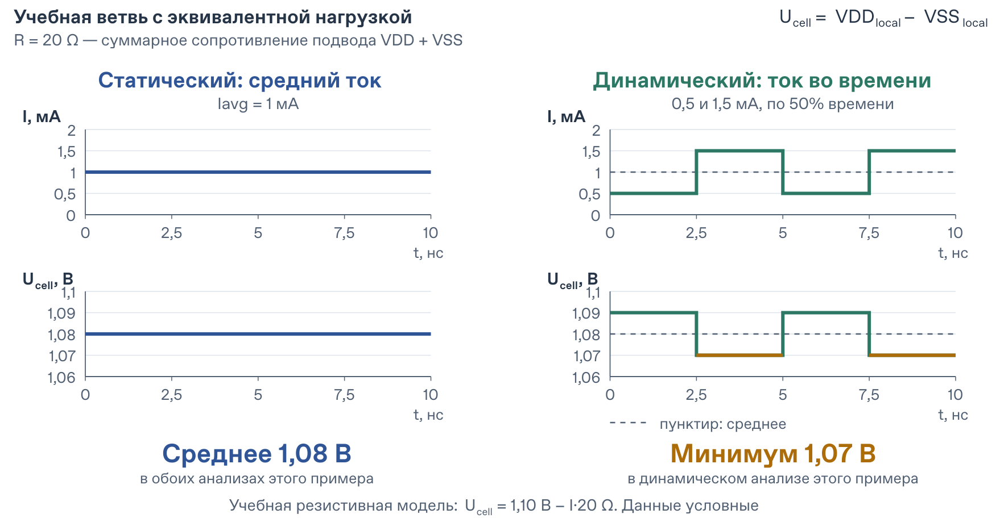

*Рисунок — Четыре нагрузки row представлены одной эквивалентной нагрузкой. Сравниваются средние и меняющиеся во времени токи той же учебной ветви. Масштабы соответствующих графиков одинаковы.*

Здесь средние напряжения совпадают благодаря одинаковому среднему току и линейной модели. При этом **динамический минимум ниже статического значения**. Интервал наблюдения на графике равен **10 нс**; это параметр учебного рисунка, а не настройка времени запуска Voltus.

В реальной PDN напряжение выбранной точки зависит от токов многих ячеек и электрической модели сети. Токи распределяются по разным путям, а сопротивления участков различаются. На временные просадки также влияют ёмкости и другие элементы, включённые в модель. Учебная резистивная схема эти эффекты не описывает.

#### Динамический расчёт в учебном маршруте

В скрипте используется режим **`dynamic_vectorless`**. Voltus формирует расчётный сценарий переключений по заданной активности и временной информации проекта, без файла переключений из функционального моделирования. По этому сценарию рассчитываются токи во времени и изменения напряжения питания.

Сценарий зависит от заданных условий и не воспроизводит конкретный функциональный запуск схемы. Вместе с результатами сохраняйте параметры активности, фактический интервал анализа и временное разрешение.

### 2.7. Что такое PGV и для чего она нужна

**PGV (Power Grid View)** — библиотечная модель питания ячеек. Она помогает Voltus связать рассчитанные токи ячеек с их выводами **VDD и VSS** и физической сетью питания блока.

Для расчёта недостаточно знать, сколько тока потребляет ячейка. Нужно также определить, **где этот ток поступает в ячейку и откуда возвращается в сеть VSS**. PGV предоставляет модель для подключения такой нагрузки. Реальные проводники сети питания блока Voltus берёт из физической базы проекта.

В работе создаём упрощённую PGV в режиме **technology-only** — файл **`techonly.cl`**. Для генерации используем **Technology LEF, LEF ячеек и QRC technology file**: они содержат сведения о слоях, выводах ячеек и электрических параметрах проводников и переходов. Подробную внутреннюю сеть питания ячеек в этой модели не рассматриваем.

Общий принцип расчёта:

| Часть расчёта | Для чего нужна |
|---|---|
| **PGV** | Описывает подключение токовой нагрузки ячеек к сети питания и предоставляет технологические данные |
| **Power analysis** | Рассчитывает, какие токи потребляют ячейки в выбранном режиме |
| **Rail analysis** | Использует PGV, рассчитанные токи, физическую сеть питания и источники, чтобы определить напряжения VDD и VSS |

<a id="fig-lab5-pgv-basics"></a>

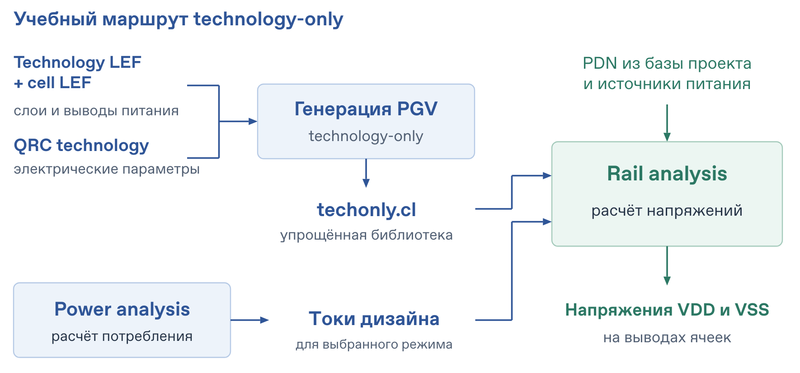

*Рисунок — Power analysis определяет токи ячеек. PGV помогает подключить эти нагрузки к сети питания, а rail analysis рассчитывает напряжения.*

Библиотеку `techonly.cl` используем и в статическом, и в динамическом анализе. В статическом расчёте к сети прикладываются **средние токи**, в динамическом — **токи, меняющиеся во времени**.

<a id="lab5-pdn-calculation"></a>

## 3. Послойный расчёт сети питания блока 45 нм

Питание подаётся снизу на боковые шины M9. Расчёт выполняем последовательно: M9 → M8 → M7. Напряжения на M9 в точках отвода определяют условия питания полос M8, а напряжения на M8 — условия питания участков M7.

<a id="fig-lab5-pdn45-abstract"></a>

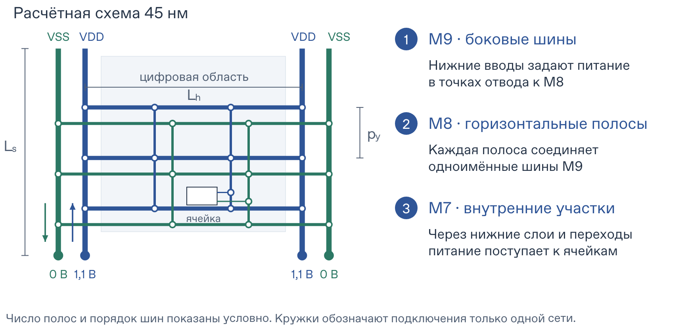

*Рисунок — Расчётная схема по floorplan. Участок ① показывает боковую шину, ② — горизонтальную полосу, ③ — соединение с ячейкой. Разводка VDD/VSS и число полос показаны условно. $L_s$ — длина боковой шины от нижнего ввода, $L_h$ — пролёт горизонтальной полосы, $p_y$ — шаг соседних горизонталей одной сети.*

<a id="lab5-pdn-inputs"></a>

### 3.1. Исходный floorplan и параметры M9

На исходном floorplan блока 45 нм слева и справа от цифровой области расположены **по две шины M9: одна VDD и одна VSS**. Всего — четыре боковые шины.

Питание подаётся на нижние концы шин. По VDD ток идёт вверх от источников к нагрузке. По VSS он возвращается вниз к источникам земли.

<a id="fig-lab5-pdn45-topology"></a>

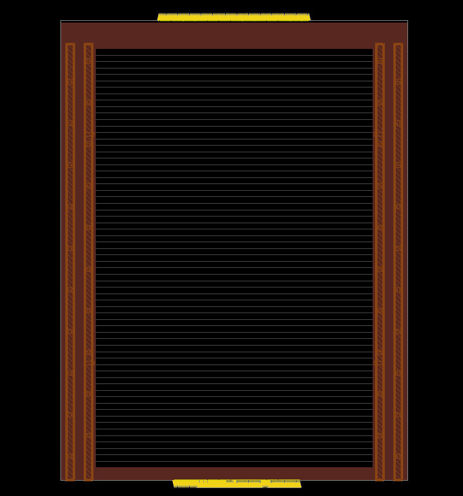

*Рисунок — Исходный floorplan. На каждой стороне находятся шины VDD и VSS слоя M9.*

Для расчёта используем следующие параметры.

| Параметр | Значение |
|---|---|
| Размер цифровой области (core) | 60 × 91 мкм |
| Размер кристалла (die) | 75 × 100 мкм |
| Число боковых шин M9 | 2 VDD и 2 VSS |
| Длина каждой шины M9 | 95 мкм |
| Ширина каждой шины M9 | 2 мкм |
| Напряжения источников | VDD = 1,1 В, VSS = 0 В |
| Сопротивление квадрата M9 | 0,030 Ом/□ — для предварительной оценки |

<a id="fig-lab5-m9-floorplan-inputs"></a>

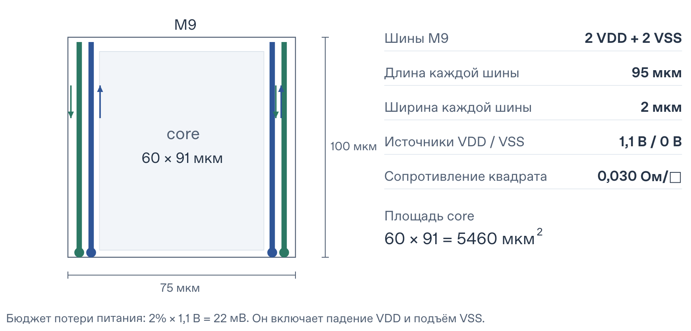

*Рисунок — Условная схема исходных шин M9. Стрелки показывают направления токов; порядок шин VDD и VSS показан условно.*

При расчёте сопротивления шины используем её длину **95 мкм**. Площадь цифровой области равна **60 × 91 = 5460 мкм²**. По этой площади распределяем нагрузку между внутренними полосами питания.

Значение сопротивления квадрата взято из [таблицы металлизации FreePDK45](https://eda.ncsu.edu/freepdk/freepdk45/). Для своего проекта проверьте его по tech LEF или модели экстракции используемого PDK.

Допустимую потерю питания в учебном примере принимаем равной **2% от 1,1 В**:

$$
\Delta V_{\mathrm{lim}}=1{,}1\cdot0{,}02=0{,}022\;\text{В}=22\;\text{мВ}.
$$

Эти **22 мВ** включают вместе падение напряжения на VDD и подъём напряжения на VSS.

<a id="lab5-pdn-currents"></a>

### 3.2. Средний ток блока и ток в боковых шинах M9

В учебном расчёте используем заданную общую мощность блока **0,62491942 мВт**. При работе со своим проектом возьмите `Total Power` из отчёта `static.rpt` и проверьте единицы по строке `Power Units` в заголовке отчёта.

Средний ток блока оцениваем по мощности и напряжению питания:

$$
I_{\mathrm{block}}\approx\frac{P}{U}
=\frac{0{,}62492\;\text{мВт}}{1{,}1\;\text{В}}
\approx 0{,}5681\;\text{мА}.
$$

Для расчёта принимаем симметричную нагрузку: левая и правая стороны питают блок поровну. Тогда через каждую из двух шин VDD проходит половина общего тока:

$$
I_{\mathrm{M9}}\approx\frac{0{,}5681}{2}
\approx 0{,}2841\;\text{мА}.
$$

**Тот же общий ток возвращается по VSS.** При симметрии он также делится поровну между двумя шинами VSS.

<a id="fig-lab5-m9-current-split"></a>

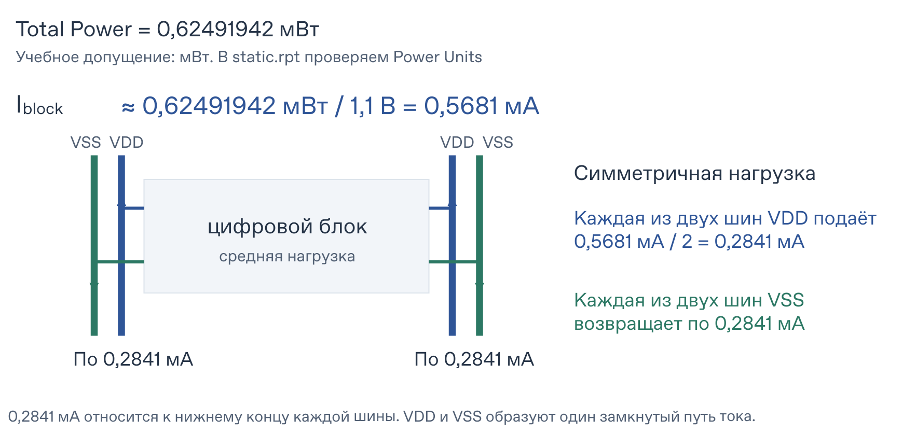

*Рисунок — При симметричной нагрузке у нижнего конца каждой шины VDD и VSS ток составляет около 0,2841 мА.*

Полученное значение **0,2841 мА относится к нижнему концу каждой шины M9**, где проходит весь ток, который эта шина подаёт в блок или возвращает к источнику.

### 3.3. Сопротивление одной боковой шины M9

Сопротивление шины прямоугольного сечения рассчитываем по формуле:

$$
R_9=\rho\frac{L}{S}=\rho\frac{L}{wt},
$$

где $\rho$ — удельное сопротивление металла, $L$ — длина шины, $w$ — её ширина, $t$ — толщина металла.

<a id="fig-lab5-m9-resistance"></a>

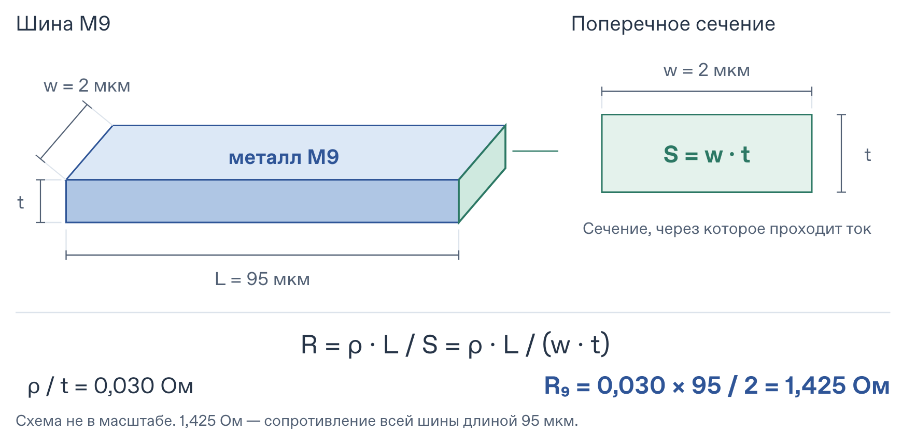

*Рисунок — Сопротивление рассчитываем по длине шины и площади её поперечного сечения. При неизменных материале и толщине более длинная шина имеет большее сопротивление, а более широкая — меньшее.*

Для принятых параметров слоя M9 отношение $\rho/t=0{,}030\;\text{Ом}$. При длине **95 мкм** и ширине **2 мкм** получаем:

$$
R_9=\frac{\rho}{t}\frac{L}{w}
=0{,}030\;\text{Ом}\cdot\frac{95\;\text{мкм}}{2\;\text{мкм}}
=\mathbf{1{,}425\;\text{Ом}}.
$$

Это сопротивление **одной шины M9 по всей длине** — от нижнего до верхнего конца.

### 3.4. Потеря напряжения на M9

В предварительном расчёте принимаем нагрузку, распределённую **равномерно вдоль шины M9**.

Внизу по VDD идёт весь ток этой шины — **0,2841 мА**. По пути часть тока уходит через отводы к ячейкам. Поэтому в середине шины остаётся примерно **0,142 мА**, а у верхнего конца ток уменьшается до нуля.

Для равномерной нагрузки средний ток **по длине шины** равен среднему между токами на её концах:

$$
I_{\text{ср}}=\frac{0{,}2841+0}{2}
\approx 0{,}142\;\text{мА}.
$$

<a id="fig-lab5-m9-drop-profile"></a>

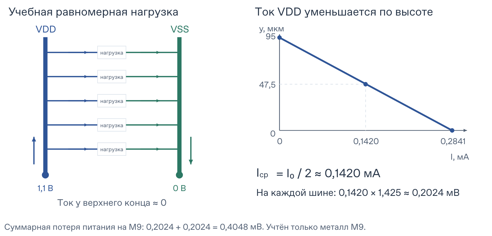

*Рисунок — Отводы к нагрузке показаны условно. При равномерной нагрузке ток убывает вдоль VDD, а по VSS тот же ток возвращается вниз.*

Из §3.3 сопротивление одной шины по всей длине равно **1,425 Ом**. По закону Ома получаем потерю от нижнего до верхнего конца:

$$
\Delta V\approx I_{\text{ср}}R
\approx\frac{0{,}2841\;\text{мА}}{2}\cdot1{,}425\;\text{Ом}
\approx 0{,}2024\;\text{мВ}.
$$

При одинаковых шинах и симметричной нагрузке на верхнем конце **VDD снижается на 0,2024 мВ**, а **VSS повышается на 0,2024 мВ**. Разность VDD−VSS в этой точке уменьшается на сумму этих потерь:

$$
\Delta V_{\text{M9}}\approx 0{,}2024+0{,}2024
=\mathbf{0{,}4048\;\text{мВ}}.
$$

Здесь учтены **только боковые шины M9**. Потери на внутренних полосах и переходах рассчитываем отдельно.

<a id="lab5-pdn-estimate"></a>

### 3.5. Напряжение в точках подключения M8 к M9

Определяем напряжение, которое приходит с M9 к полосам M8. Рассматриваем отвод **посередине M9 — на высоте 47,5 мкм** от нижнего ввода.

Сопротивление нижней половины шины равно половине полного: **1,425 / 2 = 0,7125 Ом**.

При равномерной нагрузке ток на этом участке убывает с **0,2841 мА** у нижнего ввода до **0,142 мА** в середине M9. Средний ток **нижней половины шины**:

$$
I_{\text{ср}}\approx\frac{0{,}2841+0{,}142}{2}
\approx 0{,}213\;\text{мА}.
$$

Потеря напряжения от нижнего ввода до отвода:

$$
\Delta V\approx I_{\text{ср}}R
\approx 0{,}213\;\text{мА}\cdot0{,}7125\;\text{Ом}
\approx 0{,}1518\;\text{мВ}.
$$

На VDD напряжение снижается на эту величину, а на VSS повышается. Получаем следующие значения **на M9 перед переходами к M8**.

| Величина в точке отвода | Оценка |
|---|---:|
| Потенциал VDD на M9 | 1,099848 В |
| Потенциал VSS на M9 | 0,000152 В |
| Разность VDD−VSS | 1,099696 В |
| Суммарная потеря питания до отвода | **0,3036 мВ** |

<a id="fig-lab5-m9-m8-tap"></a>

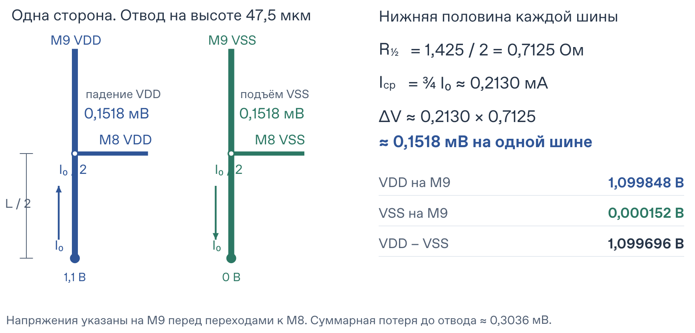

*Рисунок — Подключение M8 к боковым шинам M9. VDD и VSS показаны раздельно. Кружки обозначают переходы M9–M8. Значения в таблице относятся к проводникам M9 перед переходами.*

Потери на переходах считаем отдельно: ток через переход умножаем на его сопротивление. Для этого берём **ток ветви M8**, которая питается через данный переход.

При симметричной нагрузке и одинаковых переходах напряжения на левом и правом концах **одной полосы M8** одинаковы.

Для расчёта M8 используем **пролёт между подключениями к M9**, **ширину полосы** и **шаг полос одной сети**. Размеры полос VDD и VSS проверяем отдельно.

<a id="lab5-pdn-m8"></a>

### 3.6. Падение напряжения вдоль полосы M8

Горизонтальные полосы VDD на M8 соединяются с боковыми шинами M9. Каждая полоса получает питание **с двух концов — слева и справа**.

Для учебного примера используем следующие параметры.

| Параметр | Значение |
|---|---|
| Число полос VDD на M8 | 10 |
| Шаг между соседними полосами VDD | 9,1 мкм |
| Пролёт одной полосы между переходами на M9 | 64 мкм |
| Ширина полосы M8 | 0,8 мкм |
| Сопротивление квадрата M8 | 0,075 Ом/□ |

Для расчёта принимаем **равномерную нагрузку по всему пролёту 64 мкм** и одинаковые напряжения на концах полосы. Это учебное приближение включает подводы за пределами core шириной 60 мкм. Для своего проекта размеры берём из Innovus, а распределение нагрузки определяем по расположению и токам ячеек.

<a id="fig-lab5-m8-stripe"></a>

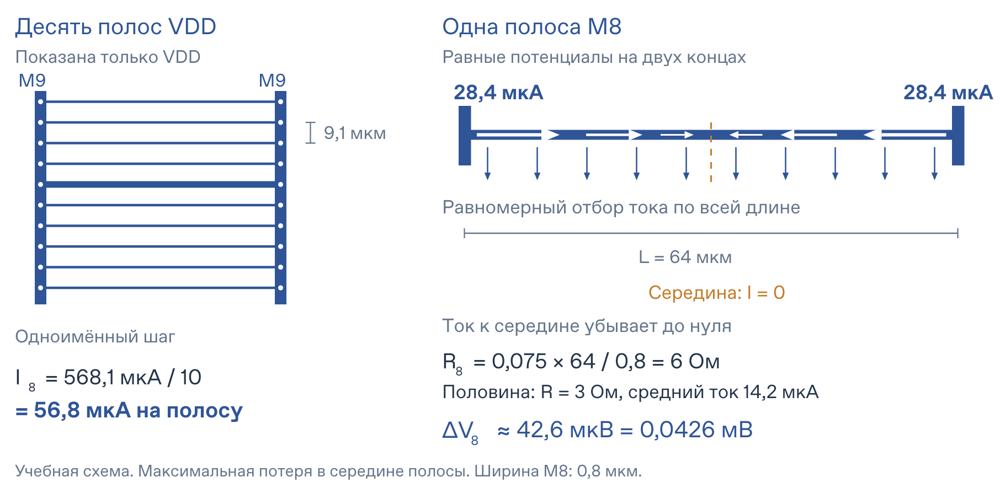

*Рисунок — Показаны только полосы VDD. Каждый конец выбранной полосы подаёт ток к её середине; по пути ток уходит к нагрузке.*

**Ток.** При одинаковой нагрузке полос на каждую приходится десятая часть тока блока: **0,5681 / 10 ≈ 0,0568 мА**. Каждый конец подаёт половину тока полосы — **0,0284 мА**. Этот же ток проходит через соответствующий переход M9–M8.

**Сопротивление.** Используем формулу из §3.3:

$$
R_8=R_\square\frac{L}{w}
=0{,}075\cdot\frac{64}{0{,}8}
=6\;\text{Ом}.
$$

От конца до середины полосы длина равна **32 мкм**, а сопротивление — **3 Ом**. Сопротивление квадрата взято из [таблицы металлизации FreePDK45](https://eda.ncsu.edu/freepdk/freepdk45/).

**Потеря до середины.** Каждая сторона питает свою половину полосы. На этом участке ток убывает от **0,0284 мА** у конца до **нуля** в середине. Средний ток по половине полосы равен **0,0142 мА**:

$$
\Delta V_8\approx I_{\text{ср}}R
\approx 0{,}0142\;\text{мА}\cdot3\;\text{Ом}
=\mathbf{0{,}0426\;\text{мВ}}.
$$

Напряжение в середине VDD ниже напряжения на каждом конце на **0,0426 мВ**. Оба подвода питают одну и ту же середину полосы.

Чтобы получить потерю от нижнего источника VDD до этой точки, складываем потери **на M9 до отвода**, **на переходе M9–M8** и **вдоль M8 до середины**.

При той же нагрузке блока меньший шаг уменьшает ток одной полосы, а большая ширина уменьшает её сопротивление. Для VSS расчёт выполняем с размерами её полос; напряжение к середине VSS повышается.

<a id="lab5-pdn-m7"></a>

### 3.7. Падение напряжения на участке M7

Вертикальные полосы VDD на M7 соединяются с горизонтальными полосами VDD на M8 через переходы. Рассматриваем **один внутренний участок M7 между соседними полосами M8 одной сети VDD**.

Для учебного примера используем следующие параметры.

| Параметр | Значение |
|---|---|
| Длина участка M7 — шаг полос VDD на M8 | 9,1 мкм |
| Ширина полосы M7 | 0,8 мкм |
| Шаг между соседними полосами VDD на M7 | 6 мкм |
| Сопротивление квадрата M7 | 0,075 Ом/□ |

<a id="fig-lab5-m7-segment"></a>

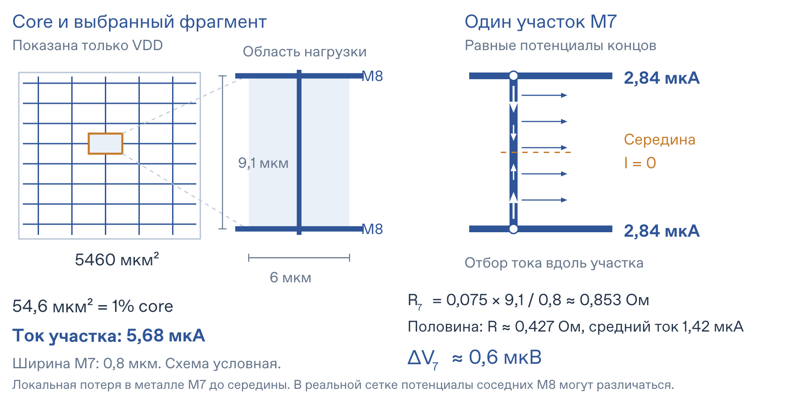

*Рисунок — Общий план кристалла, выделенный фрагмент сетки и увеличенный участок M7. Показана только сеть VDD; рамка на общем плане указывает положение рассматриваемого фрагмента.*

**Ток.** При равномерной нагрузке участок обслуживает область **6 × 9,1 = 54,6 мкм²**. Это **1%** площади цифровой области 5460 мкм². Значит, на участок приходится 1% тока блока — **5,68 мкА**.

**Сопротивление.** Используем формулу из §3.3:

$$
R_7=R_\square\frac{L}{w}
=0{,}075\cdot\frac{9{,}1}{0{,}8}
\approx 0{,}853\;\text{Ом}.
$$

От конца до середины участка длина равна **4,55 мкм**, а сопротивление — **0,427 Ом**. Сопротивление квадрата взято из [таблицы металлизации FreePDK45](https://eda.ncsu.edu/freepdk/freepdk45/).

**Потеря до середины.** Для ручной оценки принимаем **одинаковые напряжения на обоих концах** и равномерный отбор тока вдоль участка. Тогда каждый конец подаёт половину тока — **2,84 мкА**.

От конца к середине ток убывает до нуля. Средний ток по половине участка равен **1,42 мкА**:

$$
\Delta V_7\approx I_{\text{ср}}R
\approx 1{,}42\;\text{мкА}\cdot0{,}427\;\text{Ом}
\approx\mathbf{0{,}6\;\text{мкВ}}.
$$

Получаем **локальное падение в металле M7 от конца до середины участка**. Потери на переходах M8–M7 учитываем отдельно.

В реальной сетке соседние M8 подключены к M9 на разных высотах. Поэтому напряжения на концах M7 могут различаться, а токи — распределяться иначе. Voltus рассчитывает это распределение по всей сети с учётом сопротивлений проводников и переходов.

<a id="lab5-pdn-vias"></a>

### 3.8. Падение напряжения на переходах между слоями

Переход соединяет проводники на соседних слоях металла. Он может состоять из **одного или нескольких контактов — via cut**.

Падение напряжения считаем по закону Ома. Берём **общий ток через переход** и **общее сопротивление перехода**:

$$
\Delta V_{\text{via}}=I_{\text{via}}R_{\text{via}}.
$$

Ток определяем по тому, какие участки питаются через эту точку.

- **M9 → M8.** У одного конца полосы M8 через переход проходит **28,4 мкА**, как в §3.6. Второй конец полосы получает свою долю тока через отдельный переход.
- **M8 → M7.** Во внутреннем пересечении ток расходится по M7 вверх и вниз. В симметричном примере из §3.7 в каждый соседний участок идёт **2,84 мкА**. Через переход проходит их сумма: **2,84 + 2,84 = 5,68 мкА**.

<a id="fig-lab5-pg-vias"></a>

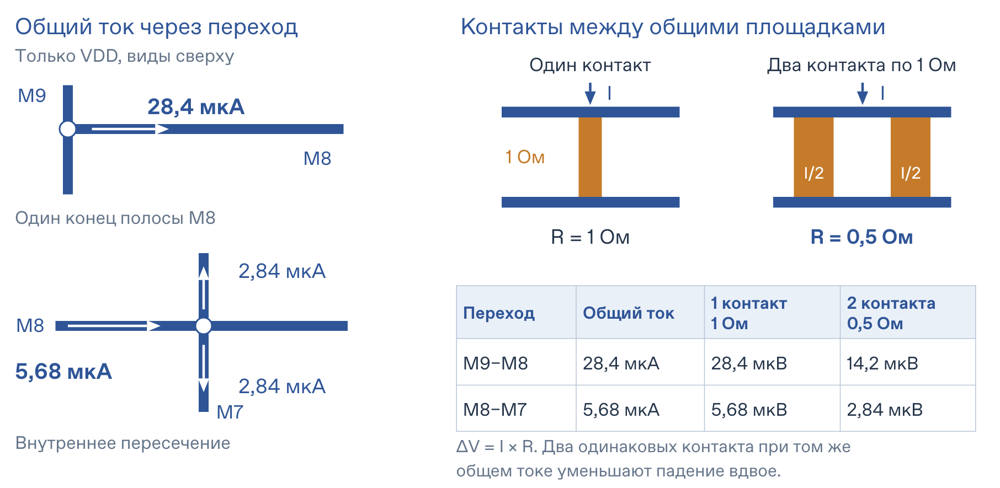

*Рисунок — Кружки на видах сверху обозначают переходы. На сечении показаны контакты между общей верхней и общей нижней площадками.*

В учебной оценке принимаем сопротивление **одного контакта равным 1 Ом**. Два одинаковых контакта между теми же площадками работают **параллельно**. Общий ток делится между ними поровну, а общее сопротивление равно **1 / 2 = 0,5 Ом**.

Сравниваем падение напряжения при **одинаковом общем токе через переход**.

| Переход | Общий ток | Один контакт, 1 Ом | Два контакта, 0,5 Ом |
|---|---:|---:|---:|
| M9 → M8 у одного конца полосы | 28,4 мкА | 28,4 мкВ | 14,2 мкВ |
| M8 → M7 во внутреннем пересечении | 5,68 мкА | 5,68 мкВ | 2,84 мкВ |

В этой модели два контакта уменьшают падение напряжения вдвое. В реальном проекте число контактов выбирают с учётом размеров площадок и правил технологии, а сопротивление перехода берут из модели экстракции.

<a id="lab5-pdn-summary"></a>

### 3.9. От ручной оценки к проверке в Voltus

Суммируем потери **вдоль одного подвода от нижнего источника VDD до середины участка M7**.

Для M9 используем отвод на высоте **47,5 мкм** из §3.5. На каждом переходе используем **один контакт сопротивлением 1 Ом**.

Как в §3.7, принимаем **одинаковые напряжения на обоих концах участка M7**. Для двух подводов используем одну и ту же оценку потери на M9. Это учебное приближение: в реальной сетке напряжения зависят от высоты отводов и нагрузки.

<a id="fig-lab5-pdn-summary"></a>

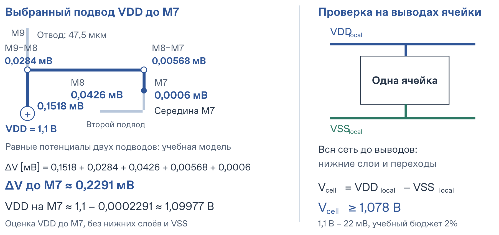

*Рисунок — Слева выделен путь ручного расчёта до точки M7. Справа показана проверка питания непосредственно на выводах ячейки.*

Складываем потери, полученные в предыдущих пунктах.

| Участок выбранного подвода | Падение VDD |
|---|---:|
| M9: от нижнего ввода до отвода на M8, §3.5 | 0,1518 мВ |
| Переход M9–M8, §3.8 | 0,0284 мВ |
| M8: от конца полосы до середины, §3.6 | 0,0426 мВ |
| Переход M8–M7, §3.8 | 0,00568 мВ |
| M7: от конца участка до середины, §3.7 | 0,0006 мВ |
| **Итого от источника до середины M7** | **≈ 0,2291 мВ** |

При напряжении источника **1,1 В** получаем:

$$
VDD_{\text{M7}}\approx 1{,}1-0{,}0002291
\approx\mathbf{1{,}09977\;\text{В}}.
$$

Оба подвода питают одну и ту же точку. В принятой симметричной модели расчёт по любому из них даёт одинаковое напряжение в середине M7.

**Проверка в Voltus.** Ручной расчёт даёт оценку VDD в точке M7. Для проверки питания ячейки в Voltus учитываем **всю сеть до её выводов**, включая нижние слои и переходы.

Для каждой ячейки берём её локальные VDD и VSS и находим:

$$
V_{\text{cell}}=VDD_{\text{local}}-VSS_{\text{local}}.
$$

При номинальном питании **1,1 В** и учебном бюджете потерь **22 мВ** питание каждой ячейки должно быть **не ниже 1,078 В**. Значения VDD и VSS берём на выводах **одной и той же ячейки**.

Ручная сумма служит оценкой порядка величины для выбранного пути. Она не учитывает взаимное перераспределение токов из-за разных потенциалов соседних M8 и не заменяет согласованного расчёта всей PDN в Voltus.

<a id="lab5-pdn-sizing"></a>

### 3.10. Как подобрать ширину и шаг полос

Для сетки M8 из §3.6 сравниваем два изменения: **увеличение ширины полос** и **уменьшение их шага**. Каждый вариант проверяем отдельно.

Во всех случаях сохраняем **ток блока 0,5681 мА**, **пролёт полос 64 мкм**, равномерную нагрузку и одинаковые напряжения на двух концах полосы. Шаг измеряем между соседними полосами **одной сети VDD**.

<a id="fig-lab5-m8-sizing"></a>

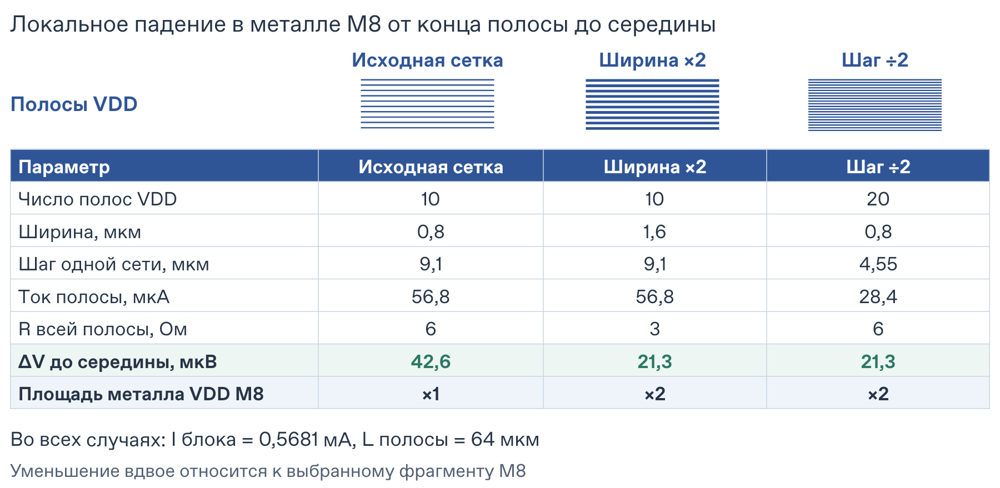

*Рисунок — Показаны только полосы VDD. Сравниваем падение в металле M8 от конца полосы до её середины.*

| Параметр | Исходная сетка | Полосы вдвое шире | Шаг вдвое меньше |
|---|---:|---:|---:|
| Число полос VDD | 10 | 10 | 20 |
| Ширина полосы | 0,8 мкм | 1,6 мкм | 0,8 мкм |
| Шаг полос VDD | 9,1 мкм | 9,1 мкм | 4,55 мкм |
| Ток одной полосы | 56,8 мкА | 56,8 мкА | 28,4 мкА |
| Сопротивление всей полосы | 6 Ом | 3 Ом | 6 Ом |
| **Падение от конца до середины M8** | **42,6 мкВ** | **21,3 мкВ** | **21,3 мкВ** |

- **Полосы вдвое шире.** Ток каждой полосы остаётся прежним, а сопротивление уменьшается вдвое.
- **Шаг вдвое меньше.** Полос становится вдвое больше. Ток блока делится между ними, поэтому ток каждой полосы уменьшается вдвое. Её сопротивление остаётся прежним.

В обоих вариантах падение **на рассматриваемом участке M8** уменьшается вдвое. При этом **суммарная площадь самих полос VDD на M8 удваивается**.

Меньший шаг M8 также сокращает участки M7 между соседними подключениями. При выборе ширины и шага оставляем место для полос VSS, переходов и сигнальной трассировки.

После построения сетки проверяем правила технологии и связность. Затем в Voltus оцениваем питание ячеек по критерию из §3.9.

<a id="lab5-pdn-final-view"></a>

### 3.11. Итоговый вид и параметры расчётного примера

Базовая сетка использует параметры из §3.1, §3.6 и §3.7. Боковые шины M9 соединяются с горизонтальными полосами M8, а M8 — с вертикальными полосами M7. Питание подаётся **снизу на шины M9**.

<a id="fig-lab5-pdn45-final"></a>

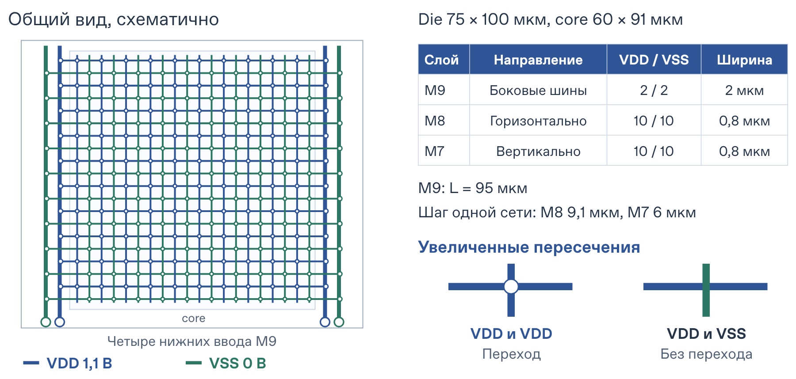

*Рисунок — Синим показана VDD, зелёным — VSS. Кружки обозначают места переходов между проводниками одной сети.*

#### Параметры расчётного примера

Размер кристалла **75 × 100 мкм**, цифровой области **60 × 91 мкм**. Напряжения источников: **VDD = 1,1 В**, **VSS = 0 В**.

| Слой | Направление | VDD, шт. | VSS, шт. | Ширина одной полосы |
|---|---|---:|---:|---:|
| **M9** | Вертикальные боковые шины | 2 | 2 | 2 мкм |
| **M8** | Горизонтальные полосы | 10 | 10 | 0,8 мкм |
| **M7** | Вертикальные полосы | 10 | 10 | 0,8 мкм |

Все расстояния между полосами ниже указаны **между их осями**. Положение первых полос относительно края core задаётся через offsets: один шаг не определяет их абсолютное положение. Десять полос одной сети образуют девять интервалов между их осями.

1. **M9.** Слева и справа расположены по одной шине VDD и VSS длиной **95 мкм**. На рисунке VSS находится ближе к краю кристалла, VDD — ближе к core.
2. **M8.** По высоте core чередуются **10 полос VDD и 10 полос VSS**. Шаг между полосами одной сети — **9,1 мкм**, между соседними VDD и VSS — **4,55 мкм**. Концы каждой полосы перекрывают шины M9 своей сети в местах переходов. Пролёт VDD между переходами равен **64 мкм**, как в §3.6.
3. **M7.** По ширине core чередуются **10 полос VDD и 10 полос VSS**. Шаг между полосами одной сети — **6 мкм**, между соседними VDD и VSS — **3 мкм**. Полосы проходят на всю высоту core.

Переходы соединяют проводники **одной и той же сети**. Для M9–M8 образуются **20 мест переходов на каждую сеть**, для M8–M7 — **100 мест на каждую сеть**. Тип перехода и число via cuts в каждом месте определяются правилами PDK. Геометрия и соединения подлежат проверке DRC и связности VDD/VSS.

В расчётном примере используются **четыре нижние точки подачи**: две VDD и две VSS. Каждая точка находится внутри нижнего конца своей шины M9. При воспроизведении примера координаты и имя слоя берут из построенной базы и записывают в отдельные файлы VDD/VSS по формату [§4.6](#lab5-power-sources).

#### Виды расчётного примера

На виде сверху различимы die, core, M7, M8, M9 и переходы. VDD и VSS выделены разными цветами.

- **Общий вид:** весь кристалл, четыре боковые шины M9 и сетка M8–M7.
- **Увеличенный фрагмент:** переход между проводниками одной сети и соседнее пересечение VDD с VSS без перехода.

<a id="lab5-electromigration"></a>

### 3.12. Электромиграция: почему повреждается металл

**Электромиграция (EM, Electromigration)** — постепенный перенос атомов металла под действием протекающего тока. Со временем он может привести к росту сопротивления, обрыву или замыканию межсоединений.

#### Что происходит физически

Электроны движутся через металл и при рассеянии передают импульс его атомам. Этот механизм называют **электронным ветром**. Тепловое движение позволяет отдельным атомам перемещаться, особенно по границам зёрен и поверхностям раздела материалов. Электронный ветер придаёт этому переносу преимущественное направление.

Если из участка уходит больше атомов, чем приходит, образуется **пустота — void**. Проводящее сечение уменьшается, сопротивление растёт. При развитии дефекта возможен обрыв. Там, где металл накапливается, может появиться **выступ — hillock**, способный вызвать замыкание с соседним проводником.

Перенос происходит **в твёрдом металле**, а повреждения накапливаются со временем. Для типичного случая Cu/Al перенос из-за электронного ветра направлен по движению электронов — **против условного направления тока**.

<a id="fig-lab5-electromigration"></a>

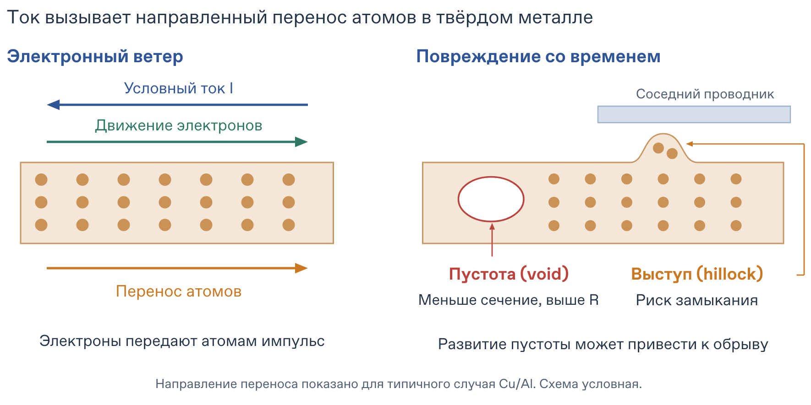

*Рисунок — Условная схема электронного ветра и образования дефектов. Направление переноса показано для типичного случая Cu/Al. Пустота уменьшает проводящее сечение; выступ может вызвать замыкание с соседним проводником.*

#### Почему важны плотность тока и температура

Среднюю по сечению плотность тока оцениваем так:

$$
j=\frac{I}{S}=\frac{I}{wt},
$$

где $I$ — ток, $S$ — площадь проводящего сечения, $w$ — ширина проводника, $t$ — толщина металла.

При том же токе большее сечение даёт меньшую плотность тока. Например, при неизменных $I$ и $t$ увеличение ширины с $w$ до $2w$ уменьшает среднюю плотность тока вдвое:

$$
j'=\frac{I}{2wt}=\frac{j}{2}.
$$

В узких перемычках и около переходов ток распределяется неравномерно: **локальная плотность может быть выше средней**. Поэтому расчёта по одной средней ширине недостаточно для проверки сложного участка.

Высокая температура ускоряет диффузию атомов. Если пустота сужает токовый путь, при том же токе оставшийся металл может сильнее нагреваться, ускоряя повреждение.

<a id="fig-lab5-em-current-density"></a>

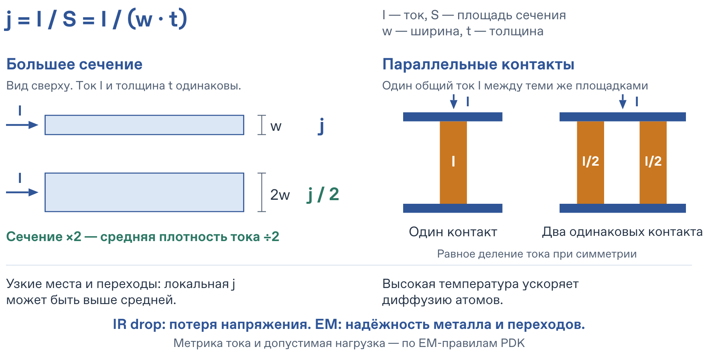

*Рисунок — Влияние ширины проводника и числа параллельных контактов при неизменном общем токе. Толщина металла постоянна. Деление тока между контактами пополам относится к одинаковым контактам с симметричным подключением.*

#### Как уменьшить риск

| Изменение | Почему помогает |
|---|---|
| **Увеличить сечение проводника** | Снижает среднюю плотность тока при том же токе |
| **Добавить полосы и пути питания** | Распределяет нагрузку между несколькими проводниками |
| **Добавить параллельные via cuts** | Распределяет ток между большим числом контактов |
| **Убрать узкие перемычки и расширить подводы к переходам** | Уменьшает локальное сгущение тока |
| **Снизить потребление и улучшить теплоотвод** | Уменьшает токи и температуру металла |

Распределение тока между проводниками и контактами проверяют расчётом: в реальной геометрии оно может быть неравномерным.

**IR-drop и EM — разные проверки.** IR-drop показывает потерю напряжения, а EM-проверка оценивает допустимость токовой нагрузки металла и переходов с точки зрения надёжности. Небольшая просадка напряжения сама по себе не подтверждает выполнение EM-ограничений.

Допустимую токовую нагрузку и используемую метрику тока — **среднюю, среднеквадратичную (RMS) или пиковую** — выбирают по EM-правилам PDK с учётом слоя, температуры и требований к сроку службы. В Voltus для EM-проверки подключают соответствующие правила и модели.

Подробнее:

- [Физика электромиграции, Stanford EE311](https://web.stanford.edu/class/ee311/NOTES/Interconnect%20Al%20Slides.pdf).
- [Расширение проводников и дополнительные vias, Siemens](https://blogs.sw.siemens.com/calibre/2016/08/22/electromigration-protection-requires-accurate-interconnect-modeling/).
- [EM-анализ в Voltus, Cadence](https://www.cadence.com/ko_KR/home/company/events/webinars/cadencetechtalk--preventing-em-failures-in-ic-designs-with-signo.html).


<a id="lab5-preparation"></a>

## 4. Подготовка и запуск

<a id="lab5-project-choice"></a>

### 4.1. Выбор проекта

В предоставленном Makefile выбран дизайн `s13207`, а его MMMC задаётся файлом `data/s13207/mmmc_45Gate.view`. Для совместимого проекта нужны RTL или netlist, ограничения, библиотеки и физические данные. Выбор проекта и требования к floorplan определены в [разделе 8](#lab5-assessment).

К началу анализа Voltus должна восстанавливаться база после routing с подключённым питанием, корректными clocks и доступными библиотеками. Состояния управляющих входов и активность должны соответствовать выбранному режиму.

<a id="lab5-voltus-inputs"></a>

### 4.2. Необходимые данные

Сохраните **физическую базу после routing** и **сигнальный SPEF** из одного прогона Innovus. По базе Voltus восстанавливает размещение и геометрию сети питания. Сигнальный SPEF содержит паразитные параметры межсоединений для расчёта мощности.

<a id="fig-lab5-voltus-inputs"></a>

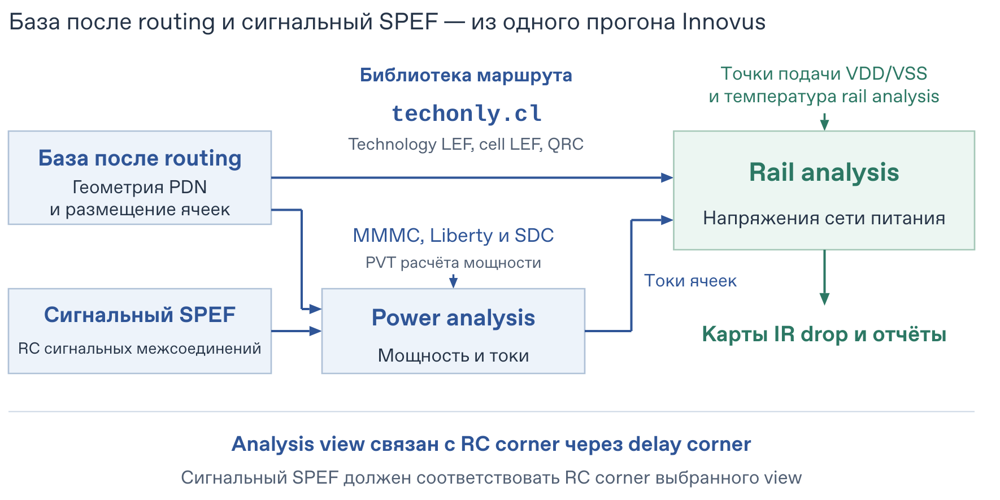

*Рисунок — Подготовка PGV, получение токов на этапе power analysis и расчёт напряжений на этапе rail analysis.*

| Откуда берём | Что понадобится | Что проверить |
|---|---|---|
| Из Innovus | База после routing и один сигнальный SPEF | Файлы относятся к одному проекту и одной версии разводки. SPEF соответствует выбранному RC corner |
| Из PDK и библиотек | Технологический LEF, LEF ячеек, технология экстракции QRC и карта слоёв, если она нужна | При генерации PGV технологический LEF стоит первым. При восстановлении базы доступны её MMMC, Liberty и SDC |
| Из настроек проекта | Analysis view, RC corner, напряжение, температура, активность и два файла точек подачи VDD/VSS | Analysis view связан с выбранным RC corner через delay corner. Точки подачи попадают на проводники нужной сети и слоя, см. §4.6 |

Сначала выполните `make voltus.pgv`, чтобы получить **`techonly.cl`**. Эта библиотека подключается в скриптах `voltus.static` и `voltus.dynamic`. **Power analysis** рассчитывает мощность и записывает токи. **Rail analysis** читает полученные токи, учитывает точки подачи и рассчитывает напряжения в физической сети питания.

<a id="lab5-voltus-control"></a>

### 4.3. Управляющие файлы

Из корня проекта запускаем нужную цель Makefile. Она подготавливает рабочий каталог, передаёт настройки в окружение и запускает Voltus. В шаблоне используется `voltus -stylus`. Параметр `-init` задаёт Tcl-скрипт, а `-log` задаёт путь к логу.

| Команда | Скрипт в `flow_scripts/` | Что выполняет |
|---|---|---|
| `make voltus.pgv` | `flow.voltus.pgv.tcl` | Создаёт и проверяет библиотеку `techonly.cl` |
| `make voltus.static` | `flow.voltus.static.tcl` | Рассчитывает среднюю мощность и статический IR drop |
| `make voltus.dynamic` | `flow.voltus.dynamic.tcl` | Запускает динамический power и rail analysis с активностью из настроек |
| `make voltus.gui` | `flow.voltus.gui.tcl` | Открывает физическую базу и сохранённые результаты расчёта |

<a id="fig-lab5-make-tcl"></a>

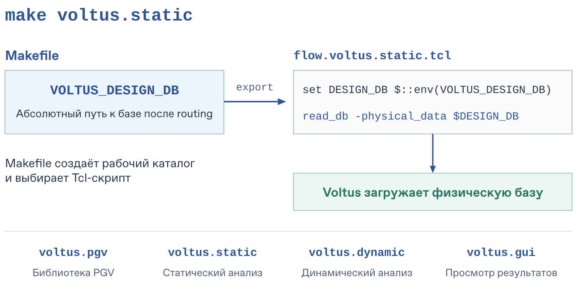

*Рисунок — Как Makefile выбирает скрипт и передаёт ему путь к базе Innovus.*

Например, в блоке **Voltus settings** Makefile переменная `VOLTUS_DESIGN_DB` задаёт путь к базе после routing. Makefile экспортирует её, а `flow.voltus.static.tcl` считывает значение из окружения и использует при загрузке базы.

```tcl
set DESIGN_DB $::env(VOLTUS_DESIGN_DB)
read_db -physical_data $DESIGN_DB
```

Перед запуском `make voltus.gui` согласуйте power DB и rail state по §4.5.

Перед первым расчётом запустите `make voltus.pgv`. Цели `voltus.static` и `voltus.dynamic` проверяют наличие готовой библиотеки по пути `VOLTUS_PGV_LIBRARY`. Команда `make -n voltus.static` позволяет посмотреть, какой скрипт и рабочий каталог выберет Makefile для статического расчёта.

### 4.4. Рабочие каталоги

Все команды `make` выполняйте **из корня проекта**. Makefile создаёт отдельные рабочие каталоги для PGV, статического и динамического анализа. Выходные каталоги уже настроены как `out`:

```makefile
export VOLTUS_PGV_OUTPUT_DIR     = $(VOLTUS_PGV_RUN_DIR)/out
export VOLTUS_STATIC_OUTPUT_DIR  = $(VOLTUS_STATIC_RUN_DIR)/out
export VOLTUS_DYNAMIC_OUTPUT_DIR = $(VOLTUS_DYNAMIC_RUN_DIR)/out
```

| Цель | Рабочий каталог | Основные результаты относительно него |
|---|---|---|
| `voltus.pgv` | `run/voltus.pgv` | `out/pgv/tech_pgv/techonly.cl`, `reports/`, `logs/voltus_pgv.log` |
| `voltus.static` | `run/voltus.static` | `out/static_power/`, `reports/static_rail/`, `logs/voltus_static.log` |
| `voltus.dynamic` | `run/voltus.dynamic` | `out/dynamic_power/`, `reports/dynamic_rail/`, `logs/voltus_dynamic.log` |
| `voltus.gui` | `run/voltus` | `logs/voltus_gui.log` |

<a id="fig-lab5-voltus-workdirs"></a>

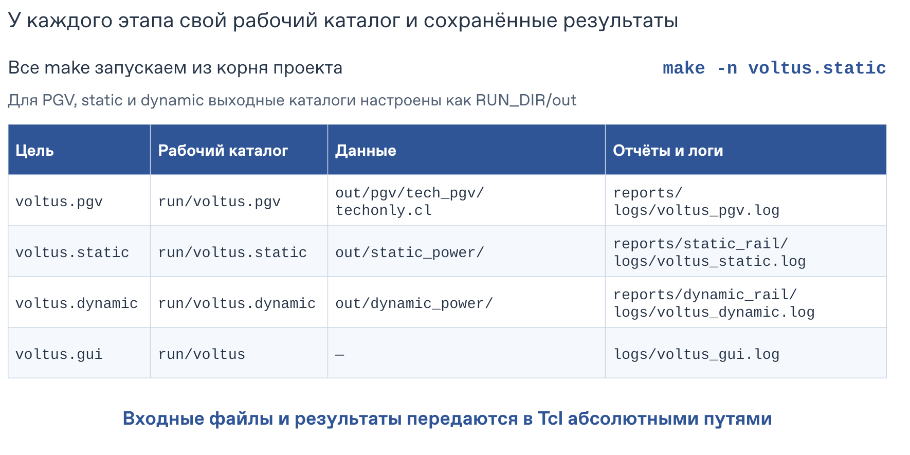

*Рисунок — Структура рабочих каталогов при настройке выходных каталогов `out`. Все команды Makefile запускаются из корня проекта.*

Путь `VOLTUS_PGV_LIBRARY` должен указывать на библиотеку в каталоге PGV. Входные файлы и результаты передаются в скрипты абсолютными путями.

### 4.5. Настройки в Makefile

#### Входные файлы и библиотеки

Пути к базе, SPEF и файлам источников задаются следующими переменными.

```makefile
export VOLTUS_DESIGN_DB    = $(ENV_DB)
export VOLTUS_SPEF_FILE    = $(INNOVUS_IMPL_OUTPUT_DIR)/$(ENV_DESIGN).$(VOLTUS_RC_CORNER).spef.gz
export VOLTUS_VDD_PAD_FILE = $(ENV_DESIGN_DIR)/VDD.pp
export VOLTUS_VSS_PAD_FILE = $(ENV_DESIGN_DIR)/VSS.pp
```

Для `ENV_DESIGN = s13207` и `VOLTUS_RC_CORNER = typ` получаем следующие пути относительно корня проекта.

| Данные | Путь |
|---|---|
| Физическая база после routing | `run/innovus_impl/db/DB.s13207.Route.enc` |
| Сигнальный SPEF | `run/innovus_impl/out/s13207.typ.spef.gz` |
| Конфигурация MMMC | `data/s13207/mmmc_45Gate.view` |
| Точки подачи VDD | `data/s13207/VDD.pp` |
| Точки подачи VSS | `data/s13207/VSS.pp` |

Полное имя базы задаётся в `ENV_DB` и передаётся в `VOLTUS_DESIGN_DB`. Имя SPEF включает RC corner. Сверьте эти настройки с файлами, созданными вашим implementation-скриптом.

| Переменная | Значение или назначение |
|---|---|
| `VOLTUS_LEF_FILES` | `$(ENV_LEF_FILES)`; технологический LEF указан первым |
| `VOLTUS_QRC_TECH_FILE` | `$(PDK_DIR)/NanGate45/qrc/NG45.tch` |
| `VOLTUS_LEF_LAYER_MAP` | `$(PDK_DIR)/NanGate45/NanGate45_lefdef.layermap` |
| `VOLTUS_POWER_PIN`, `VOLTUS_GROUND_PIN` | Выводы питания библиотечных ячеек: `VDD` и `VSS` |
| `VOLTUS_POWER_NET`, `VOLTUS_GROUND_NET` | Сети питания проекта из `ENV_POWER_NETS` и `ENV_GROUND_NETS`; в учебном варианте — `VDD` и `VSS` |
| `VOLTUS_FILLER_CELLS` | Список из `ENV_FILLER_CELLS` |
| `VOLTUS_DECAP_CELLS` | Пустое значение: список decap-ячеек в этой конфигурации не задан |
| `VOLTUS_PGV_LIBRARY` | `$(VOLTUS_PGV_DIR)/techonly.cl` |

#### Условия анализа и активность

В учебном Makefile заданы следующие значения.

```makefile
export VOLTUS_ANALYSIS_VIEW    = typ
export VOLTUS_RC_CORNER        = typ
export VOLTUS_VOLTAGE          = 1.1
export VOLTUS_TEMPERATURE      = 125
export VOLTUS_IR_DROP_FRACTION = 0.02

export VOLTUS_INPUT_ACTIVITY   = 0.2
export VOLTUS_ACTIVITY_PERIOD  = 8.0
export VOLTUS_CLOCK_GATE_RATIO = 0.5
export VOLTUS_TIME_RESOLUTION  = 50ps
```

Analysis view и RC corner — разные объекты MMMC. Проверьте в `mmmc_45Gate.view`, что выбранный analysis view связан с нужным RC corner через delay corner. Сигнальный SPEF должен соответствовать этому RC corner.

Условия расчёта мощности определяются analysis view и подключёнными Liberty-моделями. `VOLTUS_TEMPERATURE = 125` задаёт температуру **rail analysis**, а не выбирает другую Liberty-модель. Согласуйте напряжение и температуру с условиями проекта.

`VOLTUS_ACTIVITY_PERIOD` задаётся в единицах времени Liberty. Тактовые сигналы берутся из SDC восстановленной базы. `VOLTUS_TIME_RESOLUTION` задаёт временное разрешение динамического анализа. Порог `VOLTUS_IR_DROP_FRACTION = 0.02` соответствует 2% номинального напряжения.

При разовом запуске параметр можно передать в командной строке.

```bash
make voltus.static VOLTUS_INPUT_ACTIVITY=0.1
```

Для просмотра сформированной команды используйте:

```bash
make -n voltus.static
```

#### Настройки просмотра результатов

Для GUI задайте **power DB и rail state одного и того же расчёта**. Выберите статический или динамический результат и согласуйте обе переменные.

Пример просмотра статического результата из корня проекта:

```bash
make voltus.gui \
    VOLTUS_GUI_POWER_DB="$PWD/run/voltus.static/out/static_power/static_power.db" \
    VOLTUS_GUI_RAIL_STATE="$PWD/run/voltus.static/reports/static_rail/CORE_125C_avg_1"
```

Пример просмотра динамического результата:

```bash
make voltus.gui \
    VOLTUS_GUI_POWER_DB="$PWD/run/voltus.dynamic/out/dynamic_power/dynamic_power.db" \
    VOLTUS_GUI_RAIL_STATE="$PWD/run/voltus.dynamic/reports/dynamic_rail/CORE_125C_dynamic_1"
```

Имена `CORE_125C_avg_1` и `CORE_125C_dynamic_1` в примерах замените фактическими именами каталогов из лога `report_rail`. Переменная `VOLTUS_GUI_PLOT = ir` задаёт начальную карту IR drop.

<a id="lab5-power-sources"></a>

### 4.6. Точки подачи питания

Для VDD и VSS подготовьте отдельные файлы формата `xy`. В учебном Makefile используются имена `VDD.pp` и `VSS.pp`; скрипты читают их с параметром `-format xy`. Строка содержит имя источника, координаты в мкм и имя слоя. Пример одной строки для VDD выглядит так.

```text
*vsrc_name x y layer_name
vdd_left 5.5 3.5 metal9
```

Координаты и имя слоя возьмите из своей базы. Источник должен попадать внутрь проводника соответствующей сети. Число и расположение источников для задания приведены в [разделе 8](#lab5-assessment). На рисунке ниже показан расчётный пример раздела 3 с двумя нижними точками VDD и двумя VSS. Сохраните файлы источников вместе с результатами.

<a id="fig-lab5-power-sources"></a>

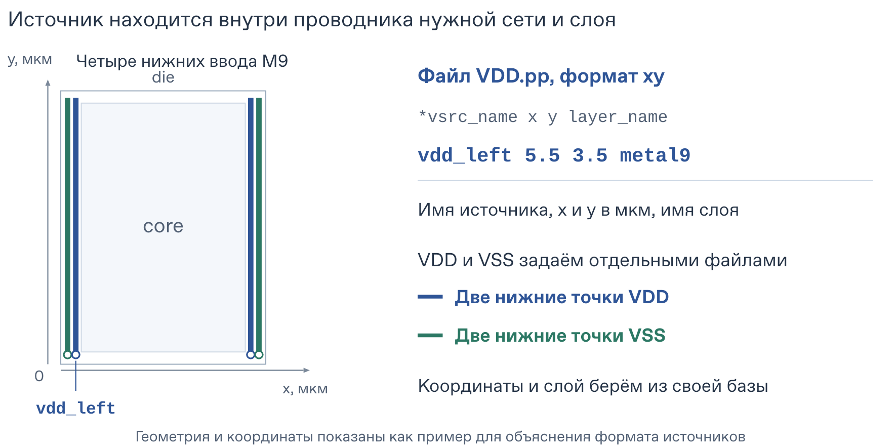

*Рисунок — Точки подачи в расчётном примере раздела 3. Источник расположен внутри проводника своей сети на указанном слое. Координаты в строке иллюстрируют формат; для расчёта используются координаты построенной базы.*

До запуска проверьте восстановление базы, доступность моделей, связь analysis view с RC corner, единицы отчётов и рабочее состояние reset.

<a id="lab5-practice"></a>

## 5. Практические этапы

Команды `bash` выполняйте в терминале Linux, команды `tcl` — в консоли Voltus. Запускайте этапы последовательно в отдельных сеансах. После проверки результата завершайте предыдущий сеанс командой `exit`.

Makefile запускает готовые Tcl-скрипты. Приведённые ниже команды поясняют их работу и помогают просматривать результаты.

<a id="lab5-physical-flow"></a>

### 5.1. Прохождение физического маршрута

1. Настройте входные файлы выбранного дизайна.
2. Если начинаете с RTL, выполните `make genus.syn`.
3. Запустите `make innovus.fp` с подготовленным скриптом floorplan.
4. Выполните `make innovus.impl`, чтобы пройти placement, CTS и routing.
5. Проведите проверки маршрута, сохраните базу после routing и соответствующий SPEF. Их пути укажите в настройках Voltus.

Перед анализом проверьте, что implementation-скрипт завершил физические операции и записал нужные выходные файлы. Конкретное содержимое этапов определяется выданными Tcl.

<a id="lab5-pgv"></a>

### 5.2. Генерация PGV

Укажите LEF, QRC technology, выводы питания ячеек и при необходимости карту слоёв. Затем выполните генерацию.

```bash
make voltus.pgv
```

В скрипте `read_physical` читает LEF, `set_pg_library_mode` задаёт тип библиотеки, `write_pg_library` создаёт PGV, а `check_pg_library` проверяет результат.

Просмотрите лог и отчёты проверки. Убедитесь, что распознаны слои, выводы питания и все нужные ячейки. Результат находится в `run/voltus.pgv/out/pgv/tech_pgv/techonly.cl`, отчёты — в `reports/`, лог — в `logs/voltus_pgv.log` внутри того же рабочего каталога. Сохраняйте объект `.cl` целиком, включая его содержимое, если инструмент создал каталог.

<a id="lab5-static"></a>

### 5.3. Статический анализ

После настройки базы, SPEF, активности и источников запустите статический расчёт.

```bash
make voltus.static
```

Power analysis восстанавливает проект, распространяет активность и рассчитывает мощность. Rail analysis читает полученные средние токи, задаёт источники и рассчитывает напряжения домена `CORE`.

| Результат относительно `run/voltus.static` | Что проверить |
|---|---|
| `out/static_power/static.rpt` | Единицы, internal/switching/leakage power и итоговую мощность |
| `out/static_power/static_power.db` | Сохранение распределения потребления для GUI |
| `out/static_power/static_VDD.ptiavg`, `static_VSS.ptiavg` | Наличие токов для обеих сетей. Имена зависят от сетей проекта |
| `reports/static_rail/` | Успешный расчёт и созданный каталог состояния |
| `logs/voltus_static.log` | Восстановленную базу, условия и сообщения power/rail analysis |

Запишите фактический путь к **конкретному rail state**. Он потребуется при открытии GUI. При почти нулевой мощности сначала проверьте clocks, активность, reset и библиотеки.

<a id="lab5-debug-threshold"></a>

При ошибке **VOLTUS-1246** проверьте `VOLTUS_IR_DROP_FRACTION` и передачу значения в `set_rail_analysis_domain -threshold`. Если токи уже загружены для текущего проекта, домен и rail analysis можно повторить в открытой сессии.

```tcl
set_rail_analysis_domain -domain_name CORE \
    -power_nets $POWER_NET \
    -ground_nets $GROUND_NET \
    -threshold $IR_DROP_FRACTION

report_rail -output_dir $RAIL_DIR -type domain CORE
```

<a id="lab5-gui"></a>

### 5.4. Просмотр сохранённых результатов в GUI

Для просмотра нужны **физическая база, power DB и rail state одного расчёта**. Укажите их в `VOLTUS_DESIGN_DB`, `VOLTUS_GUI_POWER_DB` и `VOLTUS_GUI_RAIL_STATE`.

Для static power DB находится в `run/voltus.static/out/static_power/static_power.db`. Rail state выбирайте внутри `run/voltus.static/reports/static_rail` по логу успешного `report_rail`.

Если `VOLTUS_GUI_RAIL_STATE` пуст, скрипт напечатает найденные `Static states` и `Dynamic states`. Выберите нужный каталог. Например, если статический расчёт создал состояние `CORE_125C_avg_1`, укажите согласованную пару power DB и rail state.

```bash
make voltus.gui \
    VOLTUS_GUI_POWER_DB="$PWD/run/voltus.static/out/static_power/static_power.db" \
    VOLTUS_GUI_RAIL_STATE="$PWD/run/voltus.static/reports/static_rail/CORE_125C_avg_1"
```

<a id="lab5-debug-rail-state"></a>

При ошибке **Load Data** проверьте, что указан вложенный каталог состояния. Имя `CORE_125C_avg_1` в примере замените фактическим. Проверьте также соответствие power DB и успешное завершение rail analysis.

В GUI начните с проверки связности, затем откройте потребление, токи и напряжения. Эти представления можно последовательно включить из консоли.

```tcl
gui_set_power_rail_display -plot unc
gui_set_power_rail_display -plot ip
gui_set_power_rail_display -plot tc
gui_set_power_rail_display -plot ir
```

Через **Power & Rail → Power & Rail Plots** и **Layers/Nets** выберите сеть, слои и видимость источников. Проверьте свойства выбранного объекта в **Attribute Viewer**. Порядок разбора карт приведён в [разделе 6](#lab5-results).

<a id="lab5-dynamic"></a>

### 5.5. Динамический анализ

1. Согласуйте общие настройки с static и задайте `VOLTUS_TIME_RESOLUTION`.
2. Выполните `make voltus.dynamic`.
3. В логе проверьте clocks и фактический интервал расчёта.
4. Найдите `dynamic.rpt`, `dynamic_power.db` и `dynamic_<net>.ptiavg` в `run/voltus.dynamic/out/dynamic_power`.
5. Для GUI укажите полученную power DB и соответствующий rail state из `run/voltus.dynamic/reports/dynamic_rail`. Запустите `make voltus.gui`.
6. Через **Power & Rail → Dynamic Results → Waveforms** рассмотрите токи и напряжение выбранной ячейки во времени.

Скрипт использует `dynamic_vectorless`, динамический rail analysis и сохранение voltage waveforms. Для объяснения просадки исследуйте выбранную точку и её временную зависимость. Экстремумы разных узлов на общей карте могут возникать в разные моменты времени.

<a id="lab5-results"></a>

## 6. Разбор результатов

### 6.1. Условия и сводка

Для каждого результата запишите проект, базу, версии инструмента и моделей, analysis view, RC corner, напряжение, температуру, активность и точки подачи. Укажите мощность и её составляющие с единицами из отчёта.

### 6.2. Карты потребления и питания

| Карта | Что показывает | Что проверить |
|---|---|---|
| `unc` | Неподключённые узлы | Разрывы и связность питания |
| `ip` | Мощность экземпляров | Где находятся наиболее потребляющие ячейки |
| `tc` | Токи в точках потребления | Распределение нагрузки по блоку |
| `ir` | Результат rail analysis выбранной сети | Величину, единицы, легенду и расположение источников |

На карте различайте потенциал узла и падение относительно номинала. Для VDD падение равно номинальному потенциалу минус локальный. Для VSS рассматривайте подъём относительно земли. Подтверждайте цвет численным значением выбранного объекта.

<a id="lab5-example-rail-maps"></a>

#### Примеры карт статического и динамического анализа

> **Иллюстративные примеры.** Скриншоты ниже **не соответствуют схеме сети питания из раздела 3** и приведены для знакомства с отображением результатов в GUI Voltus. Диапазоны цветовых шкал различаются: одинаковый цвет не означает одинаковую просадку. Значения читайте по легенде.

<a id="fig-lab5-static-map"></a>

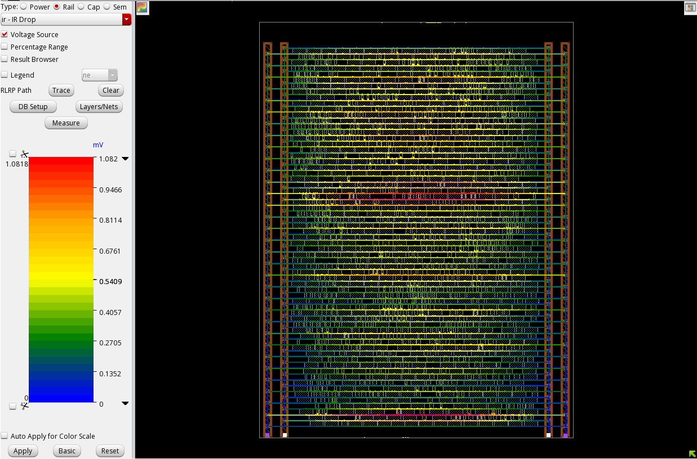

*Рисунок — Пример отображения результатов статического rail analysis. Слева показана цветовая шкала с единицами, справа — карта распределения IR drop по топологии.*

<a id="fig-lab5-dynamic-map"></a>

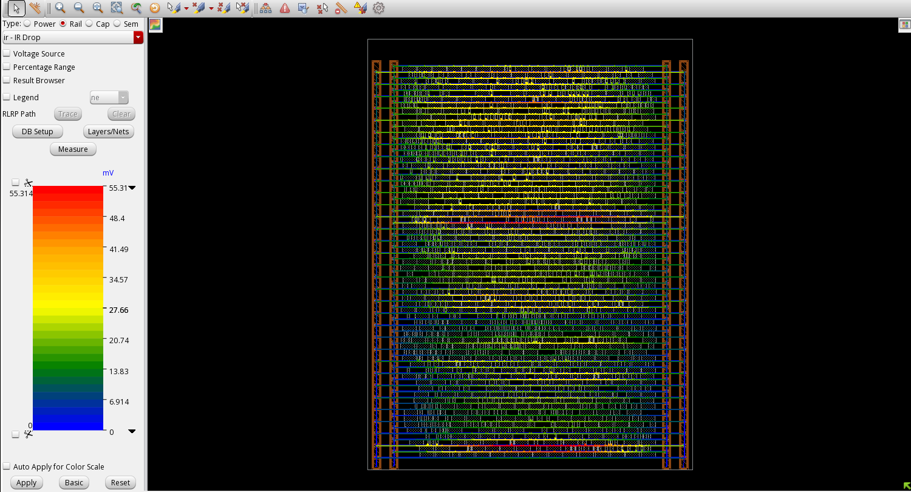

*Рисунок — Пример отображения результатов динамического rail analysis. Для интерпретации карты учитывают выбранную сеть, временную метрику и диапазон цветовой шкалы.*

При чтении карты учитывают выбранную сеть, видимые слои, положение источников, легенду и единицы. Для выбранного объекта сопоставляют цвет с численным значением. Динамическую карту интерпретируют с учётом её временной метрики или выбранного момента времени.

<a id="lab5-ir-limit-check"></a>

### 6.3. Проверка допустимой просадки

1. Зафиксируйте номинальное питание, предел и его источник. Уточните, относится он к VDD, VSS или VDD−VSS.
2. Для суммарного питания берите VDD и VSS одной ячейки. В динамике также согласуйте время и метрику.
3. Найдите худшее значение среди проверяемых ячеек и сравните с пределом. Для учебных 1,1 В и 2% минимальное VDD−VSS должно быть не ниже **1,078 В**.
4. Сохраните значение, положение объекта и сведения о превышениях. Если численный предел не задан, укажите измеренный результат и это условие.

В учебных скриптах порог домена передаётся через `VOLTUS_IR_DROP_FRACTION` в `set_rail_analysis_domain -threshold`. Значение `0.02` означает принятую долю 2%. Отдельные пороги сетей и бюджет суммарного питания требуют согласованного определения.

### 6.4. Объяснение выбранной области

Просадку объясняют нагрузкой области и её положением относительно источников, полос и переходов. Для отдельной ячейки сопоставляют токи, локальные VDD/VSS и путь подключения. Численные значения и карта вместе позволяют связать результат с геометрией сети питания.

### 6.5. Типовые ситуации

| Наблюдение | Что проверить |
|---|---|
| Мощность почти нулевая | Clocks, активность, reset и библиотеки |
| Файлы токов отсутствуют | Завершение power analysis, настройки записи и имена сетей |
| [VOLTUS-1246](#lab5-debug-threshold) | Порог домена и передачу `VOLTUS_IR_DROP_FRACTION` |
| [Load Data в GUI](#lab5-debug-rail-state) | Конкретный rail state, power DB и завершение rail analysis |
| Есть неподключённые узлы | Металл питания, переходы, PGV и точки подачи |
| Две карты выглядят одинаково | Численные значения, одинаковые границы шкалы и выбранные состояния |

<a id="lab5-save"></a>

## 7. Сохранение данных

Сохраните данные, позволяющие восстановить условия и повторно открыть результат.

| Материалы | Назначение |
|---|---|
| Makefile и использованные Tcl | Параметры и команды запуска |
| База после routing, SPEF и сведения о моделях | Исходная физическая реализация и условия |
| PGV и отчёты её проверки | Представление библиотек для анализа |
| Файлы точек подачи VDD/VSS | Подключение источников |
| Power report, power DB и токи | Потребление и нагрузка PDN |
| Полный каталог rail state | Карты, отчёты и сохранённые waveforms |
| Логи, скриншоты и выводы | Проверка и объяснение результата |

Перед сменой варианта или повторным запуском в том же рабочем каталоге сохраните предыдущий результат отдельно: новые отчёты и базы записываются по тем же путям. Для A и B используйте, например, `results/lab5/pdn_a` и `results/lab5/pdn_b`, сохраняя внутри каждого статические и динамические результаты.

До `make clean` скопируйте нужные данные **за пределы рабочих каталогов**. В предоставленном Makefile эта цель удаляет рабочие каталоги **Genus, Innovus и Voltus**, включая базы реализации, SPEF и результаты анализа.

После копирования проверьте открытие выбранного результата через GUI. Сохранённая база должна иметь доступ к библиотекам и ограничениям, на которые ссылается.

<a id="lab5-sources"></a>


## 8. Задания и защита

Выберите задание на «4» или на «5». Задание на «5» выполняется на одном дизайне с двумя вариантами сети питания; отдельный проект по заданию на «4» для него не требуется.

<a id="lab5-grade4"></a>

### 8.1. Задание на «4»: анализ проекта с готовым floorplan

Используйте свой проект и имеющийся floorplan из предыдущей работы либо готовый учебный проект преподавателя.

1. **Пройдите физический маршрут** с этим floorplan: placement → CTS → routing. Проверьте подключение питания и результаты маршрута. Сохраните базу после routing и соответствующий сигнальный SPEF.
2. **Задайте две точки подачи питания:** одну VDD и одну VSS. Место каждой точки выберите самостоятельно на кольце своей сети. Точка должна попадать внутрь проводника на указанном слое. Запишите источники в отдельные файлы `VDD.pp` и `VSS.pp` по формату [§4.6](#lab5-power-sources).
3. **Настройте и создайте PGV.** Проверьте библиотеки, напряжение, температуру, analysis view, RC corner, clocks, активность и состояние reset. Выполните `make voltus.pgv` и проверьте результат генерации.
4. **Выполните статический анализ:** `make voltus.static`. Сохраните отчёт о мощности и результаты расчёта сети питания.
5. **Выполните динамический анализ:** `make voltus.dynamic`. Используйте те же условия работы блока и те же точки подачи. Сохраните отчёты и результаты расчёта.
6. **Откройте оба результата в GUI Voltus**, сделайте скриншоты и кратко объясните, где и почему наблюдается наибольшая потеря питания.

<a id="fig-lab5-task4"></a>

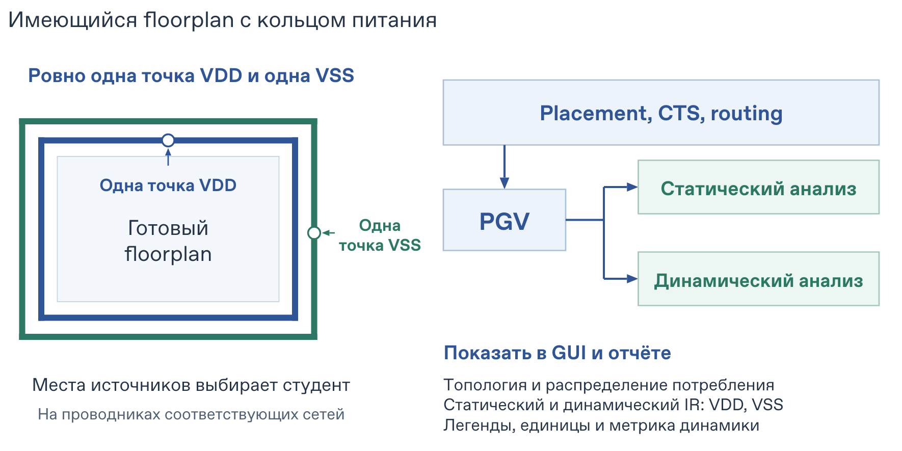

*Рисунок — Для одного проекта выполняются два анализа с одинаковыми точками подачи питания.*

<a id="lab5-grade5"></a>

### 8.2. Задание на «5»: сравнение двух сеток питания

Выполните полный маршрут для дизайна **`s13207` в NanGate45**, начиная с синтеза в Genus. Самостоятельно воспроизведите исходный floorplan из [§3.1](#lab5-pdn-inputs) и создайте **два варианта сети питания — A и B**.

#### Общая геометрия

| Параметр | Одинаково для A и B |
|---|---|
| Размер die | 75 × 100 мкм |
| Размер core | 60 × 91 мкм |
| Боковые шины M9 | Слева и справа по одной VDD и одной VSS; всего 2 VDD + 2 VSS |
| Размер каждой шины M9 | Ширина 2 мкм, длина 95 мкм |
| Подача питания | На нижние концы M9: 2 точки VDD и 2 точки VSS, как в расчётном примере |
| Напряжения источников | VDD = 1,1 В, VSS = 0 В |

Расположение core, боковых шин, выводов и источников сохраните одинаковым. Неуказанные координаты выберите по исходному рисунку и зафиксируйте в Tcl.

#### Два варианта сетки

| Параметр | Вариант A | Вариант B |
|---|---:|---:|
| M8, горизонтальные полосы | 10 VDD + 10 VSS | 20 VDD + 20 VSS |
| Ширина полосы M8 | 0,8 мкм | 1,0 мкм |
| Шаг M8 между осями полос **одной сети** | 9,1 мкм | 4,55 мкм |
| M7, вертикальные полосы | 10 VDD + 10 VSS | 15 VDD + 15 VSS |
| Ширина полосы M7 | 0,8 мкм | 1,0 мкм |
| Шаг M7 между осями полос **одной сети** | 6,0 мкм | 4,0 мкм |

Полосы VDD и VSS **чередуются**. Поэтому расстояние между осями соседних полос разных сетей вдвое меньше указанного шага. Например, для M8 варианта B оно равно **2,275 мкм**. Число полос в таблице указано **отдельно для VDD и VSS**.

В обоих вариантах соедините M9 → M8 → M7 с локальными шинами питания ячеек через допустимые проводники и переходы. Переходы устанавливайте только между проводниками одной сети. Выберите и сохраните offsets полос; проверьте фактическое количество полос, зазоры, DRC и связность питания.

<a id="fig-lab5-task5"></a>

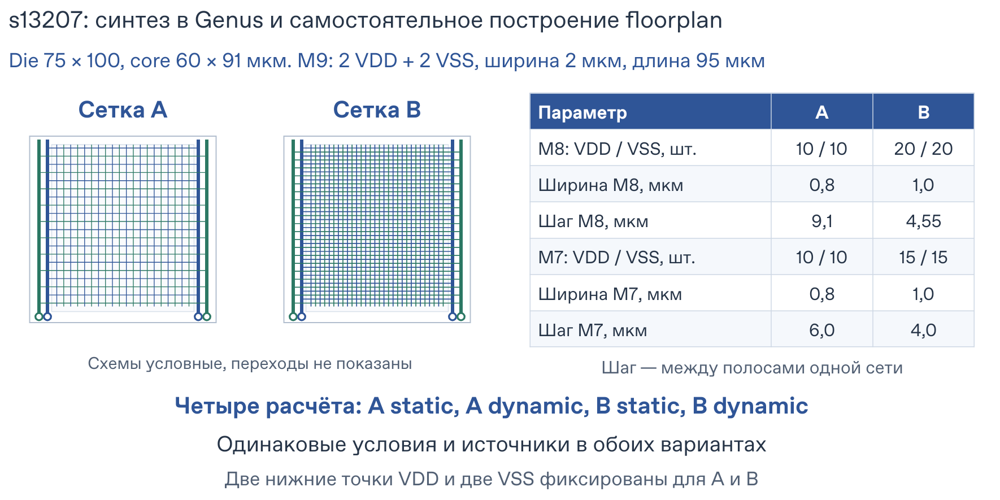

*Рисунок — В варианте B полосы M7/M8 шире и расположены чаще. Геометрия M9 и точки подачи в обоих вариантах одинаковы.*

#### Порядок выполнения

1. **Синтезируйте `s13207` в Genus.** Для двух вариантов используйте один результат синтеза и одинаковые ограничения.
2. **Создайте два floorplan** с общей геометрией и сетками A/B. Сохраните Tcl построения и отдельные базы.
3. **Для каждого варианта пройдите placement → CTS → routing.** Проверьте питание и маршрут. Сохраните отдельные базы и соответствующие им SPEF.
4. **Создайте и проверьте PGV.** Одну библиотеку можно использовать для обоих вариантов при одинаковых моделях и настройках её генерации.
5. **Для каждого варианта выполните статический и динамический анализ.** Всего должны быть получены **четыре результата: A static, A dynamic, B static и B dynamic**. Сохраняйте их раздельно, например в `results/lab5/pdn_a` и `results/lab5/pdn_b`.
6. **Сравните результаты** по таблице ниже и объясните, как изменение сетки повлияло на питание и расход металла.

#### Таблица сравнения

| Показатель | A static | A dynamic | B static | B dynamic |
|---|---|---|---|---|
| Общая средняя мощность с единицами | — | — | — | — |
| Максимальная потеря на VDD, мВ | — | — | — | — |
| Максимальный подъём VSS, мВ | — | — | — | — |
| Соответствие бюджету 22 мВ у этой ячейки | — | — | — | — |


<a id="lab5-main-questions"></a>

### 8.3. Вопросы для защиты для задания на «5»

1. Чем различаются сетки A и B? Как связан шаг одной сети с расстоянием между соседними VDD/VSS?
2. Как соединены M9, M8, M7 и локальные шины ячеек? Где находятся переходы?
3. Какие условия сравнения сохранены, а какие различия появились после физического маршрута?
4. Как ширина и количество полос влияют на сопротивление, распределение тока и ресурсы трассировки?
5. Почему при изменении сети питания нужны новые базы и соответствующие данные экстракции?
6. Почему проверки IR drop, связности, DRC и электромиграции решают разные задачи?
